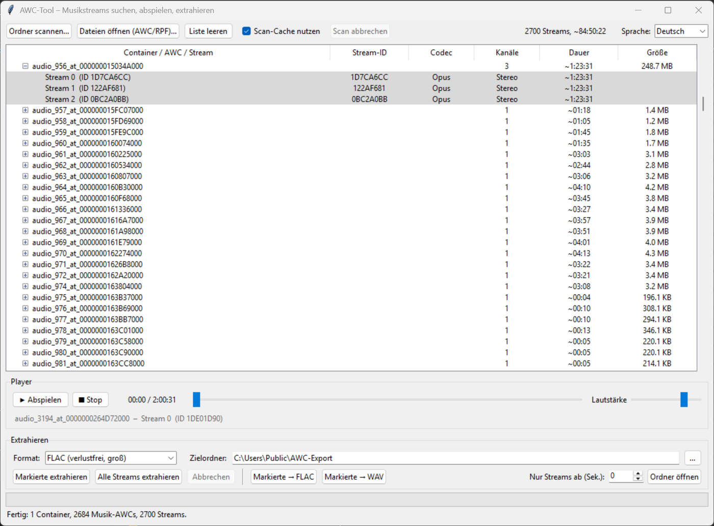

# AWC from RPF9 Extractor & AWC Radio

**Musik aus RAGE-Engine-`audio.rpf`-Archiven: das Audio extrahieren oder die Radiosender des Spiels hören – am PC und auf Android.**

🇬🇧 [English version](README.md) · ⬇️ [**Download (Releases)**](https://github.com/Albotterin/AWC_from_RPF9_Extractor/releases/latest) · 📱 [Android-App](#-die-awc-radio-app-für-android) · 📊 [Fortschritt des Radios](radio/docs/RADIO-PROGRESS.de.md)

| 🎛 AWC Audio Extractor | 📻 AWC Radio |
|:---:|:---:|
|  |  |

> ⚠️ **Bitte lies den [Disclaimer](DISCLAIMER.de.md).** Es sind keine Spieldaten enthalten: Du brauchst dein eigenes
> Exemplar des Spiels. Nichts wird entschlüsselt, kein Kopierschutz umgangen und nichts am Spiel verändert.

## Zwei Projekte in einem Repository

| | 🎛 AWC Audio Extractor | 📻 AWC Radio |
|---|---|---|
| **Wofür** | Jeden Musik-Stream finden, abspielen und extrahieren | Die Sender hören wie ein echtes Radio |
| **Ordner** | [`extractor/`](extractor/README.de.md) | [`radio/`](radio/README.de.md) |
| **Programme** | `AWC-Tool.exe` | `AWC-Radio.exe` + `AWC-Radio.apk` (Android) |
| **Anleitung** | [Extractor-Anleitung](extractor/README.de.md) | [Radio-Anleitung](radio/README.de.md) |
| **Technische Notizen** (englisch) | [AWC-/RPF9-Format](extractor/docs/FORMAT.md) | [Senderdefinitionen](radio/docs/STATIONS.md) |

Der Extractor ist die Basis: Er liest das Archiv und die AWC-Dateien. AWC Radio baut auf seinen Modulen auf – beim
Start aus dem Quellcode müssen deshalb beide Ordner nebeneinander liegen.

## Schnellstart

1. `AWC-Tool-…-win64.zip` aus dem [neuesten Release](https://github.com/Albotterin/AWC_from_RPF9_Extractor/releases/latest) laden und entpacken. Darin liegen beide Windows-Programme.
2. `ffmpeg.exe` und `ffplay.exe` ([ffmpeg.org](https://ffmpeg.org/download.html)) daneben oder in den `PATH` legen.
3. **`AWC-Tool.exe`** zum Extrahieren oder **`AWC-Radio.exe`** zum Hören starten und die `audio.rpf` deines eigenen Spiels
   wählen. Das Radio fragt zusätzlich nach der Textur-Datei `data\ttdb\ui\ttdb_ui.ttpf` (Sender-Logos).
4. **Aufs Handy:** die Android-App installieren, in AWC Radio mit **Android-Packs…** die Sender- und Podcast-Packs schreiben, sie in
   einen Ordner auf dem Handy kopieren und diesen Ordner in der App wählen.

Aus dem Quellcode (Python 3 mit tkinter; Pillow für die Logos):

```bash
git clone https://github.com/Albotterin/AWC_from_RPF9_Extractor.git
cd AWC_from_RPF9_Extractor
python extractor/awc_tool.py     # der Extractor
python radio/awc_radio.py        # das Radio
```

## 🎛 AWC Audio Extractor

* Durchsucht `.rpf`-Archive jeder Größe nach Audio-Containern – ohne Inhaltsverzeichnis.
* Schreibt die originalen Opus-Pakete 1:1 in `.opus`-Dateien (keine Neukodierung); optional FLAC, WAV oder MP3.
* Spielt jeden Stream direkt aus dem Archiv.
* Zeigt das Archiv **nach Radiosendern**: Songs, DJ-Intros und -Outros, Werbespots, Jingles und Talk, mit Senderlogo – und die **Podcasts** in einer eigenen Gruppe.
* Liest den **Score** des Spiels (die interaktive Musik): Stücke aus seinen Instrumentenspuren gemischt, gruppiert in offene
  Welt, Missionen, Stützpunkte und Aktivitäten – zum Hören, Speichern und fürs Handy (braucht FFmpeg).
* Benennt Streams aus der Spiel-Konfiguration, von der öffentlichen Credits-Seite oder aus eigenen Listen; Sender-Logos optional.
* Oberfläche auf Deutsch und Englisch.

➡️ [**Extractor-Anleitung**](extractor/README.de.md)

## 📻 AWC Radio

* **34 Sender**, darunter die Talk-Sender **WKTT** und **The Wipe** und Orte aus dem Spiel (**Jack of Hearts**, **VYB**,
  **The Vault**, **Thrillbilly Mud Club**), samt Playlists aus der Audio-Konfiguration des Spiels gelesen.
* Ein Live-Programm nach der UTC-Uhr: Jeder Sender läuft weiter, alle mit derselben Uhrzeit hören denselben Song.
* Jingles, DJ-Ansagen und Überblendungen zwischen den Songs; lange DJ-Mixe zeigen den Titel des aktuellen Abschnitts.
* **Der DJ**, wenn man ihn einschaltet: Ansagen über den Anfang und das Ende der Songs, in den Fenstern, die die Songdateien
  dafür markieren (von Haus aus aus).
* **Werbung wahlweise**: jeder Sender mit oder ohne Werbeblöcke (Standard: ohne).
* **Podcasts**: die 5 Podcasts des Spiels mit ihren 20 Folgen, abspielbar in der Android-App und am PC.
* Eine [**Android-App**](#-die-awc-radio-app-für-android) spielt dasselbe Programm auf dem Handy und im Auto – und weckt dich damit.

➡️ [**Radio-Anleitung**](radio/README.de.md)

## 📱 Die AWC-Radio-App für Android

Das Radio für die Hosentasche, fürs Auto und für den Nachttisch. **`AWC-Radio.apk`** (Version 1.11; auf einem echten Android-Handy getestet) spielt dasselbe
Live-Programm wie der PC: gleiche UTC-Uhr, gleiche Reihenfolge, gleiche Überblendungen – mit Sender-Packs derselben Version
spielen Handy und PC zur selben Zeit denselben Song.

| | |
|---|---|
| 🎧 **Hören** | Senderlogos als Raster, ein kleiner und ein großer Player in der Farbe des Senders; Wischen über das Logo wechselt den Sender. Spielt im Hintergrund weiter, mit Medien-Benachrichtigung, Sperrbildschirm-, Kopfhörer- und Bluetooth-Tasten |
| 🎙 **Podcasts** | Ein eigener Bereich neben dem Radio: Cover, Folgenliste, Player mit Positionsleiste, 15 Sekunden zurück und 30 vor; die Stelle in jeder Folge wird gemerkt, die nächste folgt von selbst |
| 🗣 **DJ** | Ansagen über den Songs, in den Einstellungen einzuschalten; die Musik tritt zurück, solange der DJ spricht |
| 🎼 **Score** | Ein eigener Reiter: offene Welt, Missionen, Stützpunkte und Aktivitäten, jeweils mit Untergruppen und Stücken |
| ⏰ **Radiowecker** | Mehrere Wecker mit Wochentagen, Sender, Lautstärke, sanftem Start und Schlummern; ein Sonnenaufgang-Bildschirm über dem Sperrbildschirm. Ist das Radio nicht zu hören, klingelt der Weckton des Handys; Wecker bleiben nach einem Neustart erhalten |
| 🚗 **Android Auto** | Die Sender als Raster mit ihren Logos, Song und Sender auf dem Player-Bildschirm, Sprachbefehle wie *„Spiele Radio On-U auf AWC Radio“* |
| 😴 **Einschlaftimer** | Stoppt das Radio nach der gewählten Zeit |
| 📢 **Werbung** | Schalter im Player und auf der Einstellungsseite, von Haus aus aus; bei 18 Sendern |
| ⚙️ **Einstellungen** | Eine Einstellungsseite: Überblenden ein/aus und 1–12 s (nur zwischen zwei Songs), Werbung, Pack-Ordner, Akku-Einstellungen, Info und Protokoll |
| 📦 **Packs** | Eine Datei je Sender (`.radiopak`), je Podcast (`.podpak`) und je Score-Gruppe (`.scorepak`), alle in einem Ordner auf dem Handy: einzeln hinzufügen oder aktualisieren, ohne alles neu zu kopieren |
| 🔒 **Offline** | Die App hat keine Internet-Berechtigung: Alles kommt aus den Packs auf dem Handy |
| 🌍 **Sprachen** | Deutsch und Englisch |
| 📋 **Voraussetzung** | Android 7.0 oder neuer |

**Einrichten**

1. `AWC-Radio.apk` installieren (aus dem [neuesten Release](https://github.com/Albotterin/AWC_from_RPF9_Extractor/releases/latest) oder selbst gebaut aus [`radio/android/`](radio/README.de.md#awc-radio-für-android)). Benachrichtigungen erlauben: Der Wecker braucht sie.
2. Am PC in AWC Radio auf **Android-Packs…** klicken, einen Ordner wählen und die Packs schreiben (Originalqualität, etwa 4,8 GB für alle 34 Sender und 0,2 GB für die Podcasts). Später werden nur neue oder geänderte Packs geschrieben. Die Score-Packs (etwa 1,6 GB) werden dort angeboten, sobald der Score im AWC-Tool gelesen wurde (Knopf **Score …**), oder aus dessen Score-Fenster geschrieben.
3. Die `.radiopak`-, `.podpak`- und `.scorepak`-Dateien in denselben Ordner auf dem Handy kopieren, die App starten und diesen Ordner einmal wählen.
4. Für Android Auto: in den Einstellungen von Android Auto etwa zehnmal auf *Version* tippen, im Drei-Punkte-Menü die Entwicklereinstellungen öffnen und *Unbekannte Quellen* aktivieren.

**Gut zu wissen**

* Die APK enthält **keine Spieldaten** und ist für alle dieselbe Datei. Sender- und Podcast-Packs enthalten Audio und Bilder aus deinem eigenen Spiel: nur für den eigenen Gebrauch, bitte nicht weitergeben.
* Das einzelne `.dat`-Pack früherer Versionen wird nicht mehr gelesen.
* Teste einen Wecker auf deinem Handy, bevor du dich darauf verlässt: Die Akkusparfunktionen mancher Hersteller beenden Apps im Hintergrund.
* Eine neuere APK lässt sich über die alte installieren.

## Fortschritt

Stand **2026-11-25** (v2.8.0), gemessen an einer 28,5 GB großen `audio.rpf`.

| Bereich | Stand | |
|---|---|---|
| Vom Scan gefundene Musik-Container | 3.008 mit 3.116 Streams (rund 101 Stunden), alle Opus und extrahierbar | ✅ |
| Songs, die die Credits für die Musiksender nennen | **792 von 809** gefunden (97,9 %) | 🟢 |
| Talk-Radio | alle 5 in den Credits genannten Sendungen, **15 Folgen** | ✅ |
| Sender in AWC Radio | 34 (darunter 3 „(Mix)“-Sender, 4 Orte aus dem Spiel und „Clubmixes“) | ✅ |
| Orte aus dem Spiel | Jack of Hearts (100 Min. DJ-Set), VYB (45 Min.), The Vault (Club, 84 Min.), Thrillbilly Mud Club (20 Songs) | ✅ |
| Werbung | 239 Spots, wahlweise im Programm von 18 Sendern | ✅ |
| DJ-Ansagen über den Songs | 714 Songs mit Intro, 687 mit Outro, 2.221 Ansagen auf 18 Sendern | ✅ |
| Extractor nach Sendern | 28 Sender und 5 Podcasts mit Logo, 3.417 DJ-Zeilen | ✅ |
| Podcasts | alle 5, die die Credits nennen, mit 20 Folgen (3 Std. 36 Min.), in der App und am PC | ✅ |
| Score | 2.543 Stücke (rund 33 Std.); 974 ab 30 Sekunden (26,5 Std.) kommen in die App-Packs | ✅ |
| Android-App | Version 1.11: Radio, Podcasts, Score, DJ, Werbung, Radiowecker, Android Auto; läuft auf einem echten Android-Handy | ✅ |
| The Vault Radio | läuft als ein langer Mix; seine 24 gelisteten Songs sind keine Einzeldateien | 🎚 |


Details zu jedem Sender: [Fortschritt des Radios](radio/docs/RADIO-PROGRESS.de.md).

### Noch offen

- [ ] 17 gelistete Songs ohne Datei: die Club-DJ-Sets (Bodega The DJ, DJ Stevie J), zwei von Worldwide FM, einer von Radio On-U.
      Kein Stream des Archivs trägt ihre Namen (Musik, Sprache und Sound-Banken durchsucht)
- [ ] Die 8 eigens geschriebenen Songs von „Honey FM – Liquid City“ (ebenfalls nicht gefunden)
- [ ] Die Titel der Podcast-Folgen sind nicht bekannt (sie sind nummeriert)
- [ ] Ein 61 Minuten langer Club-Mix bleibt in „Clubmixes“: Keine Titelliste und kein Ort der Konfiguration spielt ihn
- [ ] Die Produktnamen der Werbespots sind nicht bekannt
- [x] AWC Radio am PC spielt die Podcasts
- [x] Das Radio spricht die DJ-Intros und -Outros über die Songs (PC und App)
- [x] Die Android-App läuft auf einem echten Handy
- [x] Score und DJ der App sind auf einem echten Handy getestet
- [ ] Extractor: nur Opus; das RPF9-Inhaltsverzeichnis wird nicht gelesen, es gibt also keine Dateinamen

### Meilensteine

| Version | Datum | Neu dazugekommen |
|---|---|---|
| [v1.0.0](https://github.com/Albotterin/AWC_from_RPF9_Extractor/releases/tag/v1.0.0) | 2026-11-22 | 🎛 Archiv-Scan, Player, verlustfreie Extraktion |
| [v1.1.0](https://github.com/Albotterin/AWC_from_RPF9_Extractor/releases/tag/v1.1.0) | 2026-11-22 | 🎛 Gruppen nach Lage im Archiv |
| [v1.7.0](https://github.com/Albotterin/AWC_from_RPF9_Extractor/releases/tag/v1.7.0) | 2026-11-23 | 🎛 Songnamen und Sender-Logos · 📻 erstes AWC Radio |
| [v1.8.0](https://github.com/Albotterin/AWC_from_RPF9_Extractor/releases/tag/v1.8.0) | 2026-11-23 | 📻 Programm nach der UTC-Uhr |
| [v1.9.0](https://github.com/Albotterin/AWC_from_RPF9_Extractor/releases/tag/v1.9.0) | 2026-11-23 | 📻 Überblendungen |
| [v2.0.0](https://github.com/Albotterin/AWC_from_RPF9_Extractor/releases/tag/v2.0.0) | 2026-11-23 | 📻 Android-App und Sender-Packs |
| [v2.1.0](https://github.com/Albotterin/AWC_from_RPF9_Extractor/releases/tag/v2.1.0) | 2026-11-24 | 📻 Mehr Sender und Songs, Mix-Sender |
| [v2.2.0](https://github.com/Albotterin/AWC_from_RPF9_Extractor/releases/tag/v2.2.0) | 2026-11-24 | 📻 The Vault Radio, Clubmixes, Titel innerhalb der Mixe |
| [v2.3.0](https://github.com/Albotterin/AWC_from_RPF9_Extractor/releases/tag/v2.3.0) | 2026-11-24 | 📻 Android Auto, neues App-Design |
| [v2.4.0](https://github.com/Albotterin/AWC_from_RPF9_Extractor/releases/tag/v2.4.0) | 2026-11-25 | 📻 Talk-Radio und vollständige Sender-Playlists |
| [v2.4.1](https://github.com/Albotterin/AWC_from_RPF9_Extractor/releases/tag/v2.4.1) | 2026-11-25 | 🎛 📻 Eigener Leser für die Sender-Logos, kein Download nötig |
| [v2.5.0](https://github.com/Albotterin/AWC_from_RPF9_Extractor/releases/tag/v2.5.0) | 2026-11-25 | 📻 Ein Pack je Sender, App 1.5 mit Radiowecker und neuem Design, Sender für Orte aus dem Spiel |
| [v2.6.0](https://github.com/Albotterin/AWC_from_RPF9_Extractor/releases/tag/v2.6.0) | 2026-11-25 | 📻 Werbung wahlweise (App 1.6) · 🎛 Ansicht nach Radiosendern mit DJ-Intros, Outros und Werbung |
| [v2.7.0](https://github.com/Albotterin/AWC_from_RPF9_Extractor/releases/tag/v2.7.0) | 2026-11-25 | 🎙 Podcasts in App (1.8, eigener Bereich, `.podpak`) und Extractor |
| [v2.8.0](https://github.com/Albotterin/AWC_from_RPF9_Extractor/releases/tag/v2.8.0) | 2026-11-25 | 🎼 Der Score des Spiels (AWC-Tool und App 1.11, `.scorepak`) · 📻 DJ-Ansagen, Podcasts am PC, Überblend-Einstellung · 🎛 40 weitere Musik-Container |

## Aufbau des Repositorys

```
extractor/     AWC Audio Extractor: Programm, gemeinsame Module, Format-Notizen, Screenshots
radio/         AWC Radio: Programm, Sender-Leser, Fortschritt, Screenshots
  android/     die Android-App (Quelltext, Build-Skript, Tests)
DISCLAIMER.md  was die Programme tun und nicht tun, und deine Pflichten (auf Deutsch: DISCLAIMER.de.md)
LICENSE        MIT
README.md      diese Übersicht auf Englisch (README.de.md auf Deutsch)
```

## Rechtlicher Hinweis

**Der vollständige Text steht im [Disclaimer](DISCLAIMER.de.md).** Kurz gesagt:

* Dieses Repository enthält **nur Quellcode und Dokumentation**. Es enthält **keine Spieldateien, keine Archive und
  keine extrahierten Audiodaten** – und wird das auch nie.
* Du brauchst deine eigenen Dateien aus einem Spiel, das du rechtmäßig besitzt. Für extrahiertes Audio bist du selbst
  verantwortlich – es unterliegt dem Urheberrecht der Rechteinhaber. Private, nicht-kommerzielle Analyse und
  Archivierung ist eine Sache, die Weitergabe in der Regel nicht erlaubt. Ein Pack enthält Spiel-Audio: bitte
  nicht weitergeben.
* Die Screenshots zeigen Senderlogos und Songtitel aus dem Spiel nur, um zu illustrieren, was die Programme aus deinen
  eigenen Dateien lesen.
* Das Projekt steht in **keiner Verbindung** zu Rockstar Games, Take-Two oder anderen Publishern und wird von
  diesen nicht unterstützt. Alle Marken gehören ihren jeweiligen Inhabern.

## Credits und Lizenz

Das AWC-Block-Layout wurde mit Hilfe von [**vgmstream**](https://github.com/vgmstream/vgmstream) erarbeitet; allgemeines
AWC/RPF-Wissen stammt aus der Community, v. a. von [**CodeWalker**](https://github.com/dexyfex/CodeWalker). Das Layout der
Audio-Konfiguration folgt den Notizen des Projekts **Leonida** (ItsNotRexed). Abspielen und
Konvertieren übernimmt [FFmpeg](https://ffmpeg.org/).

[MIT](LICENSE) – gilt nur für den Quellcode, nicht für Spieldaten.
