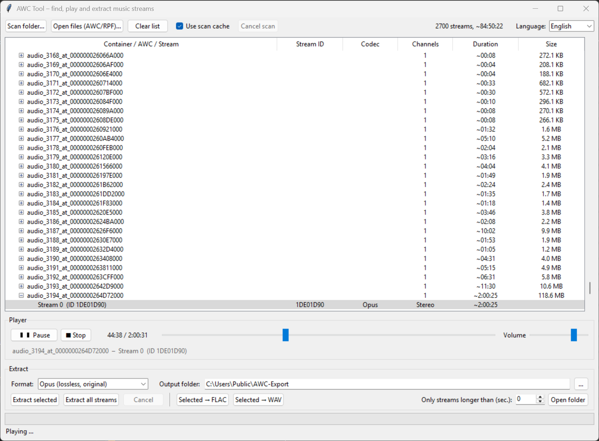
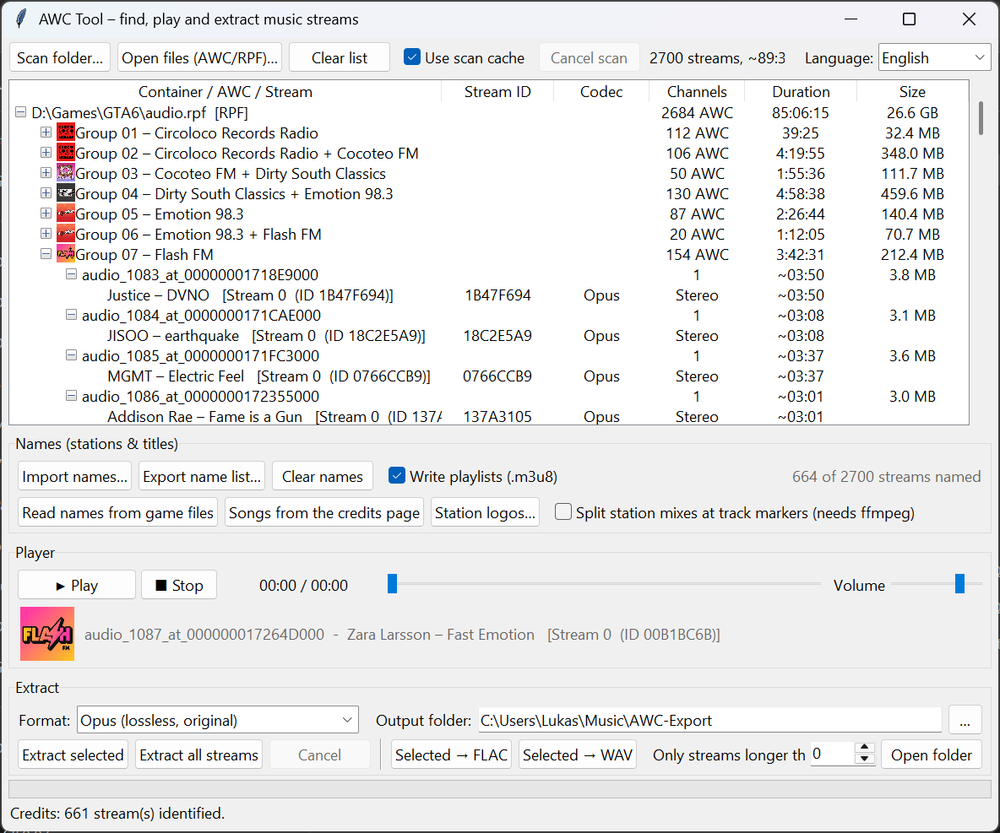
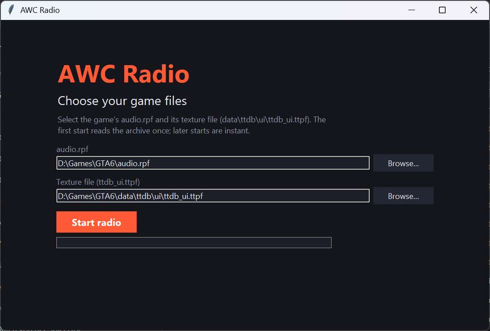

# AWC from RPF9 Extractor

**Find, play and extract music streams from RAGE-engine `.rpf` archives (RPF9) and `.awc` files – with a simple GUI.**

🇩🇪 [Deutsche Version](README.de.md) · 📄 [Technical format notes](docs/FORMAT.md) · ⬇️ [**Download (Releases)**](https://github.com/Albotterin/AWC_from_RPF9_Extractor/releases/latest)


---

## Table of contents

1. [What does it do?](#what-does-it-do)
2. [Legal notice – please read](#legal-notice--please-read)
3. [Features](#features)
4. [Screenshots](#screenshots)
5. [Requirements & installation](#requirements--installation)
6. [Usage](#usage)
7. [Output formats and file naming](#output-formats-and-file-naming)
8. [How it works (short version)](#how-it-works-short-version)
9. [Grouping: which files belong together?](#grouping-which-files-belong-together)
10. [Using the code as a library](#using-the-code-as-a-library)
11. [Building a standalone `.exe`](#building-a-standalone-exe)
12. [Languages](#languages)
13. [Limitations](#limitations)
14. [Troubleshooting](#troubleshooting)
15. [Project layout](#project-layout)
16. [Credits](#credits)
17. [License](#license)

---

## What does it do?

Some games built on Rockstar's RAGE engine store their audio in big `audio.rpf` archives. The music is kept in
**AWC** containers (`ADAT` header) inside those archives. The newer **RPF9** archives can't be opened by the usual
RPF7 tools, and their table of contents is not readable, so the AWC files can't simply be looked up by name.

This tool takes a different route:

1. **It scans the raw archive for AWC headers** (`ADAT`) – no table of contents needed. A 28 GB archive takes
   about 6 minutes on a normal disk; the result is cached, so the next scan is instant.
2. **It recognises the music containers** (multichannel AWC with a *stream-format* chunk) and reads their
   stream IDs, codec, channel layout and duration.
3. **It decodes the container layout** (blocks → per-channel entries → Opus packets) and **rewrites the original
   Opus packets 1:1 into standard Ogg Opus files** – there is *no re-encoding*, so the audio is bit-identical to what
   the game plays.
4. Optionally it **converts to FLAC, WAV or MP3** with ffmpeg, and it can **play any stream directly** from the
   archive, with seek and volume control.
5. Because the archive's table of contents (and with it every file name) is unreadable, it **groups the AWCs by their
   position in the archive** – files of one folder are stored back to back, so a group is typically one radio station
   or one folder. You can **name the groups yourself** (right-click), and the names become export folder names.

You can point it at a single `.awc`, a single `.rpf`, or a **whole folder** – it searches all subfolders for
every `.rpf` and `.awc` file and lists all music streams it finds.

> Example run on a 28.5 GB `audio.rpf`: 6,636 AWC headers found, 2,968 of them music containers with
> 2,992 streams (Opus, 48 kHz) ≈ 96 hours of audio ≈ 5 GB as `.opus` files.

## Legal notice – please read

* This repository contains **only source code and documentation**. It contains **no game files, no archives
  and no extracted audio**, and it never will.
* You need to supply your own files, from a game you legally own. What you do with extracted audio is your
  responsibility – the audio is subject to the copyright of its owners. Personal, non-commercial analysis and
  archiving is one thing; redistributing it is generally not allowed.
* This project is **not affiliated with, endorsed by or connected to** Rockstar Games, Take-Two or any other
  publisher. All trademarks belong to their respective owners.

## Features

| | |
|---|---|
| 🔍 **Archive scanning** | Header scan of `.rpf` files of any size (64 MiB read chunks, strict validation, skips over found AWCs). |
| 📂 **Folder mode** | Choose a folder – all subfolders are searched for `*.rpf` and `*.awc`. |
| 🌳 **Tree view** | Container → group → AWC → stream, with stream ID, codec, stereo/mono, duration and size. |
| 🗂 **Groups** | AWCs are clustered by their position in the archive (≈ one folder / radio station each). Right-click a group → **Rename group…**; the name is used for the export folder. |
| ▶️ **Player** | Play any stream straight from the archive (play/pause/stop, seek bar, volume). Uses `ffplay`. |
| 💾 **Extraction** | Opus (lossless remux), FLAC, WAV (16-bit PCM) or MP3 (320 kbit/s). Select streams, whole AWCs or whole containers. |
| ⏱ **Duration filter** | "Only streams longer than N seconds" – skips the many short snippets. |
| 🛡 **Safety checks** | Estimates output size, warns when the disk is too small, asks before big jobs. |
| ⚡ **Fast** | Pure-Python Ogg muxer with a zlib-based CRC: ~100 MB of Opus in about a second. |
| 🧠 **Scan cache** | Scan results are cached in `%APPDATA%\AWC-Tool\cache` (can be disabled). |
| 📻 **AWC Radio + Android app** | A web-radio style player for the game's stations that runs live by the UTC clock, and an Android app that plays the same programme from a station pack file. |
| 🌍 **Multilingual UI** | English and Deutsch, switchable at runtime; easy to add more. |
| ❌ **Cancelable** | Scans and extractions can be cancelled; partial files are removed. |

## Screenshots

**Browsing the music containers of an archive.** Multi-stream AWCs (here: 3 stereo streams) expand into their
streams. The selection can be extracted or played.


**Groups.** Without a readable table of contents the tool clusters the AWCs by where they sit in the archive.
Each *Group NN* is typically one folder / radio station. Right-click a group to give it a name (here:
"My station name" – the name is stored on your PC and used for the export folder).


**Playing a stream** directly from the archive – here at 44:38 of a two-hour stream, with the seek bar.



**Extracting** a multi-stream AWC to FLAC, with progress bar, status line and a *Cancel* button.


**Language switch** – the same window in German; the whole UI (including tree rows and status line) changes
instantly.


**Named stations.** After *Songs from the credits page* every group is named after its radio station and gets its
logo (rows and player); titles, artists and stations are filled in for the streams the list recognises.



**AWC Radio** (companion app): the stations with their logos on the left; the selected one plays its songs with a
jingle after every 2-4 songs.


On the first start the radio asks for the game's `audio.rpf` and its texture file:



*The screenshots show station logos and song titles from the game; they are only illustrations of what the tool
reads from your own game files. Nothing from the game is shipped with the tool.*

## Requirements & installation

* **Windows** (the GUI and the packaged `.exe` target Windows; the core modules are plain Python and portable).
* **Python 3 with tkinter** (included in the standard python.org installer; developed and tested with 3.14). No `pip` packages are needed, except **Pillow** (`pip install pillow`) for the optional station logos.
* **ffmpeg + ffplay** – only needed for *playback* and for *FLAC/WAV/MP3* export.
  Opus extraction works without them. Get ffmpeg from <https://ffmpeg.org/download.html> (for example the
  "full build" from gyan.dev) and either put `ffmpeg.exe` and `ffplay.exe` **next to the program** or into your `PATH`.

```bash
git clone https://github.com/Albotterin/AWC_from_RPF9_Extractor.git
cd AWC_from_RPF9_Extractor
python awc_tool.py
```

On Windows you can also double-click `Start AWC-Tool.bat`.

## Usage

### GUI

1. Click **Scan folder…** and choose a folder containing `.rpf` / `.awc` files (subfolders are included), or use
   **Open files (AWC/RPF)…** for individual files. You can also pass paths on the command line:
   ```bash
   python awc_tool.py "D:\game\audio.rpf"
   python awc_tool.py "D:\game"            # whole folder
   python awc_tool.py --lang=de            # start in German
   ```
2. Wait for the scan. The progress bar shows how much of the archive has been read and how many music AWCs were
   found so far. Results are cached.
3. **Browse** the tree. Double-click a stream to **play** it (the first play of a stream takes a moment because the
   stream is extracted to a temporary cache first – about a second per 100 MB).
4. **Extract**: select streams, AWCs or a whole container (Ctrl/Shift for multiple), choose a **format** and an
   **output folder**, and click **Extract selected**. **Extract all streams** processes everything in the list.
   *Selected → FLAC* and *Selected → WAV* are one-click shortcuts.
5. Use **Only streams longer than (sec.)** to skip short snippets (e.g. `60` keeps only streams of a minute or more).
6. **Name the groups** (optional): right-click a *Group NN* row → **Rename group…** (e.g. after listening to a few
   tracks). Names are stored in `%APPDATA%\AWC-Tool\group_names.json` and become part of the export folder name.
7. **Names** (optional) – the AWC files only contain 32-bit hash IDs, no names:
   * **Read names from game files** hashes the internal names in the game's own audio config (the zlib part at the
     start of `audio.rpf`) and fills in titles for the streams it recognises (roughly a third of the music streams
     in the sample archive; internal titles only, no artists). It also remembers the station names found there and
     offers them in **Rename group…**.
   * **Songs from the credits page** downloads the soundtrack list of the publisher's public credits page
     (`rockstargames.com/VI/credits`: every station with its songs and artists), hashes the titles the same way the
     game does and sets **title, artist and station** for every stream it recognises (about 660 of the music streams
     in the sample archive; most of the stations are matched almost completely). The station is stored per track
     and used for tags, playlists and as the suggestion in **Rename group…**. If the download fails you can pick
     the page saved from your browser instead. The list is not shipped with the tool and stays on your PC.
     The groups are then **named after their station** automatically (the stations lie in the archive one after the
     other; a group that spans two stations is called `A + B`). Names you set yourself are never overwritten, and
     tracks without a title inherit the station of their neighbours for tags and playlists.
   * **Import names…** reads a CSV/TXT/JSON list (by stream ID or by internal name), **Export name list…** writes
     a template to fill in, and right-click → **Set title / artist…** names a single stream.
   * Named streams get `Artist - Title` file names and Opus/FLAC/MP3 tags on export, plus optional `.m3u8`
     playlists. Names stay on your PC (`%APPDATA%\AWC-Tool\track_names.json`); nothing is shipped with the tool.
8. **Station logos** (optional): while a track plays, the logo of its radio station is shown. The logos are stored in
   the game's texture pool (`data\ttdb\ui\ttdb_ui.ttpf`, next to `audio.rpf`) in a format this tool does not decode.
   On the first start a dialog offers to download the decoder of the [Leonida](https://github.com/ItsNotRexed/Leonida)
   project (a few files from GitHub, GPL-3, saved with its LICENSE to `%APPDATA%\AWC-Tool\leonida\`; they are not part
   of this tool). Afterwards the logos are cut out of your own game files into `%APPDATA%\AWC-Tool\icons\`. The
   button **Station logos…** repeats the step. The logos are saved at the game's full size (256 × 256). *Note (2026-11-24): the Leonida repository is currently not reachable on GitHub (404), so the decoder download fails for new users; logos that were cut out earlier keep working.* 23 stations are known; the station comes from the credits list
   (see step 7). Group rows get a small logo, and FLAC/MP3 exports carry the logo as cover picture. Nothing from the
   game is shipped with the tool.
9. **Station mixes** (optional): a few very long streams (40-120 min) are whole radio mixes. The game stores a
   `trackid` marker for every track it plays; the tool shows them as chapters under the stream (double-click to play
   from there) and names them when the matching standalone track has a title. Tick **Split station mixes at track
   markers** to also write every chapter as its own file in a `... (tracks)` folder (needs ffmpeg; the cut is a
   stream copy, accurate to the marker). The marker meaning is inferred, see `docs/FORMAT.md`.

### AWC Radio (companion app)

`awc_radio.py` (or `Start AWC-Radio.bat` / `AWC-Radio.exe`) is a small web-radio style player on top of the same
code. On the first start you pick the game's `audio.rpf` and its texture file (`data\ttdb\ui\ttdb_ui.ttpf`). The app
reads the archive once (the same scan cache as the main tool; several minutes the first time) and then lists every
station with its logo.

**Where the stations come from:** the game's own audio config (the zlib part at the start of `audio.rpf`) defines each
radio station with its complete playlist, including titles and artists, so the music stations and the two **talk radio**
stations (**WKTT** and **The Wipe**) are read straight from there. The song list of the public credits page is used for
the spelling of the names and for the club DJ sets and mixes, which are still matched by their names. See
[docs/FORMAT.md](docs/FORMAT.md).

Click a station to tune in: its songs play one after the other, and after every 2-4 songs a short jingle is played. On
talk radio an "item" is a whole show episode (its parts joined, 10-23 minutes). The programme is calculated from the
**UTC clock** (a new order every UTC day, jingles included), so every station keeps "running" in the background: switch
to another station and back and you land where the first one is by now. Everybody with the same game files and the same
clock hears the same song at the same second (accurate to about a second; the one song that would cross midnight UTC is
cut). Neighbouring songs and jingles are **crossfaded** for 3 seconds (shorter around short jingles), at the same moment
for everybody. There is no skip button - like on a real radio; after a pause, play resumes live. Later starts are
instant. **Jingles** are the short recordings (idents and DJ talk) that only this station uses; for the club DJ sets they
are an educated guess. The adverts that several stations share are not played. Needs `ffplay` like the main tool.

**Progress:** 792 of 809 songs the credits list for the music stations (97.9 %) are found, and all 15 talk show episodes;
see [station progress](docs/RADIO-PROGRESS.md) for every station.
Long DJ mixes are played as stations too: **The Vault Radio**, extra "(Mix)" stations for Radio On-U, Worldwide FM and The Sniper Of La Perle, and **Clubmixes** (the club and DJ-venue mixes that cannot be assigned to a station yet). While a mix plays, the title of the current part is shown (from the markers in the mix; the part is only named where the marker points to a known song).

### AWC Radio for Android

The phone app plays the same live programme as the PC: same UTC clock, same order, same crossfades. It is two files:

* **`AWC-Radio.apk`** - the app, from the [release page](../../releases/latest). The same file for everybody, no game data
  inside. Android 7.0 or newer, English and German. It keeps playing in the background with a media notification,
  lock-screen and headset buttons (previous / next station, pause) and has a sleep timer. **Android Auto** is supported: the stations show up as a grid with their logos, the player screen shows the song and station, and voice commands ("play Radio On-U on AWC Radio") work. Because the app does not come from the Play Store, switch on *Unknown sources* in Android Auto's developer settings first.
* **A station pack (`.dat`)** - made on the PC: in AWC Radio click **Android pack...**, tick the stations and save. It holds
  the songs of those stations in the game's own quality (about 128 kbit/s, not re-encoded; about 4 GB for all 30 stations),
  their logos and the programme. Copy it to the phone, start the app and pick the file once; the songs are played straight
  out of it.

The pack contains game audio: for your own use only, do not share it. Without a pack the app is empty.
`python awc_radio.py --export-pack out.dat [--stations "Name" ...]` writes a pack without opening a window.
The source and the build scripts of the app are in `android/`.

### Player controls

| Control | Action |
|---|---|
| ▶ Play / ❚❚ Pause | Start / pause (pausing remembers the position). |
| ■ Stop | Stop and rewind. |
| Seek bar | Drag and release to jump. |
| Volume | Applied when you release the slider. |

### Command line options

```
python awc_tool.py [--lang=en|de] [folder | file.awc | file.rpf ...]
python awc_tool.py --selftest <report.txt> <file.awc>     # diagnostics (used for the built exe)
```

## Output formats and file naming

| Format | Size (stereo, per hour) | Notes |
|---|---|---|
| **Opus** | ≈ 58 MB | Original packets in an Ogg container – **bit-identical audio, no re-encode**. Plays in VLC, foobar2000, ffmpeg, … |
| FLAC | ≈ 600 MB | Lossless *copy of the decoded* audio (the source is lossy Opus). |
| WAV | ≈ 700 MB | 16-bit PCM, 48 kHz. Very large. |
| MP3 | ≈ 140 MB | 320 kbit/s, re-encoded from the decoded audio. |

> The source audio is lossy (Opus, 128 kbit/s stereo). FLAC/WAV don't add quality – they are for compatibility
> with tools that can't read Opus.

Files are written to `<output folder>/<container name>/<group folder>/<awc name>_stream<N>_<STREAMID>.<ext>`,
for example:

```
AWC-Export/audio/group_04/audio_956_at_000000015034A000_stream0_1D7CA6CC.opus
AWC-Export/audio/group_04_My station name/audio_956_at_000000015034A000_stream0_1D7CA6CC.opus   (after naming the group)
```

* `audio` – name of the `.rpf` the AWC was found in (standalone `.awc` files are written directly into the output folder),
* `group_04` – the group (see [Grouping](#grouping-which-files-belong-together)), plus your own name if you gave one,
* `956` – running number of the AWC header in the archive,
* `000000015034A000` – byte offset of the AWC inside the archive,
* `stream0` / `1D7CA6CC` – stream index and the stream's 32-bit ID (a hash; real names are not stored in the AWC).

## How it works (short version)

```
audio.rpf (28 GB)
  └─ scan for "ADAT" ──► candidate offsets ──► strict header check ──► AWC at offset X, length L
        └─ read chunk table: 0x48 stream format · 0x55 data · 0xA3 seek table · 0xBD events
              └─ data chunk = blocks of 512 KiB
                    └─ block: channel table · seek tables · 0x800-byte units of [u16 length | Opus packet]*
                          └─ Opus packets ──► Ogg pages (OpusHead/OpusTags + CRC) ──► .opus
                                                  └─ ffmpeg ──► FLAC / WAV / MP3
```

The full byte-level description is in **[docs/FORMAT.md](docs/FORMAT.md)**.

## Grouping: which files belong together?

The RPF9 table of contents can't be read, so the archive doesn't tell us which AWC belongs to which radio station or
folder. The tool uses a **heuristic based on the physical layout**:

* Files of one folder are stored **back to back**; between two folders there is usually a larger gap (and a
  non-music AWC). A new group starts where the gap to the previous music AWC is **≥ 64 KiB** or where the running AWC
  number jumps (= a non-music AWC sits in between).
* In the sample archive this gave **29 groups** (one of them ~300 files, a few with only 4–7 long pieces).
* Typical group contents: songs (3–5 min), many short voice/jingle snippets, and sometimes a 1–2 hour continuous
  stream. Groups that contain only very short snippets are probably not radio at all.

**What it can't do:** it can't tell you which station a group is (the tool only suggests station names found in
the game config). A group is *probably* one folder, but that is an inference, not a fact. Listen to a few tracks, then name the groups in the tool.
Handy: `Only streams longer than (sec.)` with `90` keeps just the real tracks.

In code: `awc_core.add_groups(items)` sets `item["g"]` (1-based) on the items returned by the scanner.

## Using the code as a library

`awc_core.py` has no GUI dependency:

```python
import awc_core as core

# 1) find all music AWCs in an archive (cached on disk)
items, total_awc, from_cache = core.scan_container_cached(r"D:\game\audio.rpf")
print(len(items), "music AWCs of", total_awc, "AWC headers")

# 2) extract every stream of one AWC to .opus files
ref = core.AwcRef(items[0])
jobs = {s.index: f"out_{s.index}_{s.id:08X}.opus" for s in ref.streams if s.supported}
seconds = ref.extract(jobs, progress=lambda f: print(f"{f:.0%}"))   # -> {stream_index: seconds}
```

## Building a standalone `.exe`

```bat
build_exe.bat
```

This installs PyInstaller (if needed) and creates `dist\AWC-Tool.exe`. Copy `ffmpeg.exe` and `ffplay.exe` next to
it for playback and conversion. (The `.exe` and ffmpeg are intentionally **not** part of this repository.)

> Antivirus tools sometimes flag PyInstaller one-file executables as false positives. If that bothers you, run
> from source instead.

## Languages

The UI language can be switched with the **Language** box (top right) at any time; the choice is stored in
`%APPDATA%\AWC-Tool\settings.json`. Currently: **English** (default) and **Deutsch**.

To add a language, edit `awc_i18n.py`: add an entry to `LANGUAGES` and a table with the same keys to `STRINGS`
(missing keys fall back to English). Pull requests with translations are welcome.

## Limitations

* **Only music containers with the Opus codec (`0x0B`)** are supported. Other AWC kinds (sound effects, speech,
  Vorbis/ADPCM/XMA banks, …) are detected as "not a music container" and skipped.
* The **RPF9 table of contents is not parsed** (it appears to be encrypted/obfuscated), so there are **no real
  file names** – only offsets and stream IDs. The tool relies on the fact that the AWC payloads inside the archive
  are stored uncompressed and unencrypted.
* **Groups are a layout heuristic** (see above), not real folders; names have to be given by you.
* Developed and tested against the AWC files of **one** RPF9 archive. Other games/versions may use different
  codecs or layouts.
* Durations in the list (marked with `~`) come from the sample count in the stream header. In the sample archive they
  matched the lengths in the game's own audio config within 1 % for 2236 of 2240 streams; the exact length is still
  confirmed after extraction/playback.
* Seeking while playing restarts `ffplay` at the new position (a short gap is normal).
* Playback and FLAC/WAV/MP3 need ffmpeg/ffplay.

## Troubleshooting

| Problem | Fix |
|---|---|
| "ffmpeg missing" warning at start | Put `ffmpeg.exe` and `ffplay.exe` next to the program or into `PATH`. Opus extraction still works. |
| Scanning a big archive is slow | It is disk-bound (≈ 80 MB/s on a hard disk, much faster on an SSD). The result is cached – the second run is instant. |
| I want to rescan | Untick **Use scan cache** (or delete `%APPDATA%\AWC-Tool\cache`). |
| A file says "Not a multichannel music container" | It is an AWC of another kind (SFX/speech) – not supported. |
| Playback has no sound | Check your default audio device; test `ffplay` on its own. |
| Not enough disk space warning | WAV/FLAC are big – use Opus, or filter by duration. |

## Project layout

```
awc_tool.py        GUI (tkinter): tree, player, extraction, language switch
awc_core.py        AWC parser, RPF scanner, Ogg Opus writer (no GUI dependencies)
awc_i18n.py        Translations (English, Deutsch) + settings
awc_names.py       Track/station name store, import/export, tags, playlists
awc_config.py      Reads internal names from the game's audio config
awc_gamedata.py    Reads the radio stations and their playlists from that config
awc_credits.py     Parses the public credits page and matches its songs to stream IDs
awc_icons.py       Optional: downloads the Leonida texture decoder and cuts the station logos out of the game
awc_radio.py       AWC Radio: web-radio style player for the game's stations (separate program)
awc_android.py     Station pack (.dat) writer for the Android app, and its dialog in AWC Radio
android/           The Android app: Java source, build_apk.py, make_logo.py, tests
Start AWC-Tool.bat Launcher
build_exe.bat      Builds dist\AWC-Tool.exe with PyInstaller
docs/FORMAT.md     Technical notes on the AWC/RPF9 layout
docs/RADIO-PROGRESS.md  How many credited songs were found per station (also in German)
docs/screenshots/  Images used in this README
```

## Credits

The block layout of AWC music streams was worked out by reading the open-source
[**vgmstream**](https://github.com/vgmstream/vgmstream) code (`awc.c`, `awc_streamfile.h`) and by analysing sample
files; general AWC/RPF knowledge comes from the community, notably
[**CodeWalker**](https://github.com/dexyfex/CodeWalker). Opus is by Xiph.Org / IETF (RFC 6716), Ogg by Xiph.Org
(RFC 3533, RFC 7845). Playback and conversion use [FFmpeg](https://ffmpeg.org/).

The layout of the game's audio config (the name list, the 29-bit stream IDs as `joaat` hashes) follows the notes of
[**Leonida**](https://github.com/ItsNotRexed/Leonida) (`docs/audio_config.md`, `docs/audio.md`). The `0xBD` marker
findings in `docs/FORMAT.md` were reported back there.

The Android app's launcher icon was drawn with the fan-made typeface *GTA Art Deco* (not part of this repository).

## License

[MIT](LICENSE) – applies to the source code in this repository only, not to any game data.
