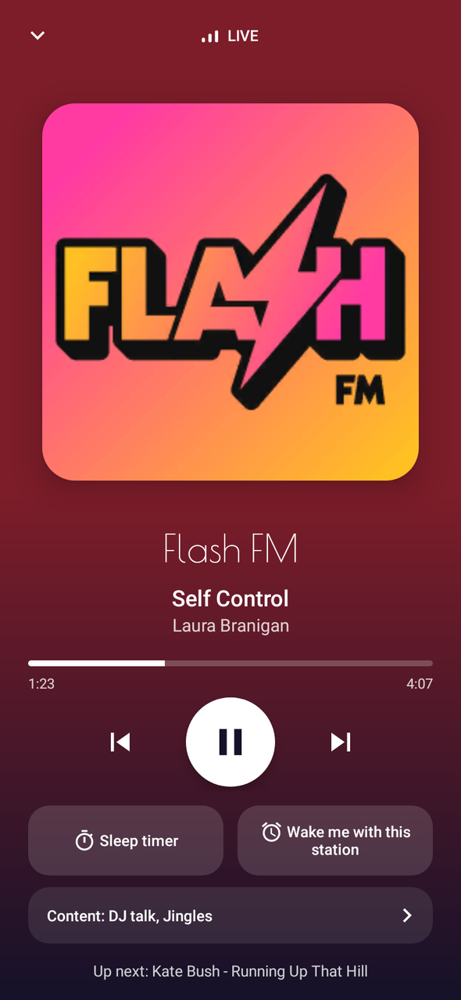

# AWC from RPF9 Extractor & AWC Radio

**Music from RAGE-engine `audio.rpf` archives: extract the audio, or listen to the game's radio stations – on the PC and on Android.**

🇩🇪 [Deutsche Version](README.de.md) · ⬇️ [**Download (Releases)**](https://github.com/Albotterin/AWC_from_RPF9_Extractor/releases/latest) · 📱 [Android app](#-awc-radio-app-for-android) · 📊 [Radio progress](radio/docs/RADIO-PROGRESS.md)

| 🎛 AWC Audio Extractor | 📻 AWC Radio |
|:---:|:---:|
|  |  |

| 📱 AWC Radio on Android – stations | 📱 AWC Radio on Android – player |
|:---:|:---:|
|  |  |

> ⚠️ **Please read the [disclaimer](DISCLAIMER.md).** No game data is included: you need your own copy of the game.
> Nothing is decrypted, no copy protection is circumvented and nothing in the game is changed.

## Two projects in one repository

| | 🎛 AWC Audio Extractor | 📻 AWC Radio |
|---|---|---|
| **What for** | Find, play and extract every music stream | Listen to the stations like on a real radio |
| **Folder** | [`extractor/`](extractor/README.md) | [`radio/`](radio/README.md) |
| **Programs** | `AWC-Tool.exe` | `AWC-Radio.exe` + `AWC-Radio.apk` (Android) |
| **Guide** | [Extractor guide](extractor/README.md) | [Radio guide](radio/README.md) |
| **Technical notes** | [AWC / RPF9 format](extractor/docs/FORMAT.md) | [Station definitions](radio/docs/STATIONS.md) |

The extractor is the base: it reads the archive and the AWC files. AWC Radio builds on its modules, so keep both
folders next to each other when you run from source.

## Quick start

1. Download `AWC-Tool-…-win64.zip` from the [latest release](https://github.com/Albotterin/AWC_from_RPF9_Extractor/releases/latest) and unzip it. It holds both Windows programs.
2. Put `ffmpeg.exe` and `ffplay.exe` ([ffmpeg.org](https://ffmpeg.org/download.html)) next to them, or into your `PATH`.
3. Start **`AWC-Tool.exe`** to extract, or **`AWC-Radio.exe`** to listen, and pick the `audio.rpf` of your own game.
   Keep the game's `data.rpf` in the same folder to get the titles of the podcast episodes and of the parts of the mixes.
   The radio also asks for the texture file `data\ttdb\ui\ttdb_ui.ttpf` (station logos).
4. **On the phone:** install the Android app, write the station and podcast packs with **Android packs…** in AWC Radio, copy them
   into one folder on the phone and choose that folder in the app.

From source (Python 3 with tkinter; Pillow for the logos):

```bash
git clone https://github.com/Albotterin/AWC_from_RPF9_Extractor.git
cd AWC_from_RPF9_Extractor
python extractor/awc_tool.py     # the extractor
python radio/awc_radio.py        # the radio
```

## 🎛 AWC Audio Extractor

* Scans `.rpf` archives of any size for audio containers – no table of contents needed.
* Writes the original Opus packets 1:1 into `.opus` files (no re-encoding); optionally FLAC, WAV or MP3.
* Plays every stream straight from the archive.
* Shows an archive **by radio station**: songs, DJ intros and outros, adverts, jingles and talk, with the station logo – plus the **podcasts** and the **score** in groups of their own.
* Reads the game's **score** (the interactive music): pieces mixed from its instrument layers, grouped into open world,
  missions, compounds and activities, to listen to, save or put on the phone (needs FFmpeg).
* Names streams from the game's own config, from the public credits page or from your own lists; station logos optional.
* English and German interface.

➡️ [**Extractor guide**](extractor/README.md)

## 📻 AWC Radio

* **34 stations**, among them the talk stations **WKTT** and **The Wipe** and the game's venues (**Jack of Hearts**, **VYB**,
  **The Vault**, **Thrillbilly Mud Club**), read with their playlists from the game's own audio config.
* A live programme by the clock: every station keeps running, everybody with the same time and time zone hears the same.
* **The game's own programme rules**, read from your audio config: how often adverts, news, DJ links and idents come, what
  changes at night, how the talk stations string their shows together.
* **Transitions as in the game**: jingles, adverts, songs and talk overlap as the game's mixing rules say, and the DJ's
  talk gets the station's own music underneath. What is spoken is not faded: the song steps back under it.
* Long DJ mixes show the title of the current part.
* **The DJ**, if you switch him on: intros and outros spoken over the songs, in the windows the song files mark for them
  (default: off).
* **You choose what runs between the songs**: adverts, news, DJ talk, talk and shows (with **Honey FM**'s night show
  **Liquid City**) and jingles, each with a switch of its own. At first DJ talk and jingles are on.
* **Podcasts**: the game's 5 podcasts with their 20 episodes and titles, playable in the Android app and on the PC.
* **On-Demand** (app): search songs and artists like in a music app, with a playlist for every station and one for the
  game's soundtrack album.
* An [**Android app**](#-awc-radio-app-for-android) plays the same programme on the phone and in the car, and wakes you with it.

➡️ [**Radio guide**](radio/README.md)

## 📱 AWC Radio app for Android

The radio for your pocket, your car and your bedside. **`AWC-Radio.apk`** (version 1.21, tested on a real
Android phone) plays the same live programme as
the PC: same clock, same order, same transitions – with station packs from the same version, phone and PC play the same
at the same time.

| | |
|---|---|
| 🎧 **Listening** | Station logos as a grid, a mini player and a large player in the colour of the station; swipe over the logo to change the station. Keeps playing in the background with a media notification, lock screen, headset and Bluetooth buttons |
| 🔎 **On-Demand** | A tab like a music app: search for songs and artists, all songs, the artists, a playlist for every station and one for the soundtrack album with its cover; shuffle and repeat |
| 🎙 **Podcasts** | An area of their own next to the radio: covers, episode list, a player with seek bar, 15 seconds back and 30 forward; the place in every episode is remembered and the next one follows by itself |
| 🗣 **DJ over songs** | Intros and outros over the songs, switched on in the settings; the music steps back while the DJ talks |
| 🎼 **Score** | A tab of its own: open world, missions, compounds, activities and the music in places (lifts, lobbies, minigolf), each with sub groups and pieces; a search over the whole score for pieces, missions and places |
| ⏰ **Radio alarm** | Several alarms with weekdays, station, volume, gentle start and snooze; a sunrise screen over the lock screen. If the radio cannot be heard, the phone's own alarm tone rings; alarms survive a restart |
| 🚗 **Android Auto** | The stations as a grid with their logos, song and station on the player screen, voice commands such as *"play Radio On-U on AWC Radio"* |
| 😴 **Sleep timer** | Stops the radio after the time you choose |
| 🧩 **Widgets** | A player for the home screen (logo, title, previous, pause, next; resizable) and a tile per station that plays it with one tap |
| 🔄 **Updates** | A newer version is proposed with its changelog, at the start (at most once a day) or with a button in the settings; the app downloads and installs it itself after Android's confirmation (the browser stays as a fallback) |
| 📢 **Between the songs** | A switch each for adverts, news, DJ talk, talk and shows, and jingles, in the player and on the settings page; a station offers what it has |
| ⚙️ **Settings** | A settings page: crossfade on/off and 1-12 s (clubs and mixes only; the other stations are mixed as in the game), what runs between the songs, DJ over songs, pack folder, updates, battery settings, info and log |
| 📦 **Packs** | One file per station (`.radiopak`), per podcast (`.podpak`), one with the news (`.newspak`), one for the soundtrack album (`.playlistpak`) and one per score group (`.scorepak`), all in one folder on the phone: add or update single ones without copying everything again |
| 🔒 **Offline** | Everything it plays comes from the packs on the phone. The internet is used for updates only: asking github.com for the list of releases (can be switched off) and loading the new app when you choose to |
| 🌍 **Languages** | English and German |
| 📋 **Needs** | Android 7.0 or newer |

**Set it up**

1. Install `AWC-Radio.apk` (from the [latest release](https://github.com/Albotterin/AWC_from_RPF9_Extractor/releases/latest), or build it from [`radio/android/`](radio/README.md#awc-radio-for-android)). Allow notifications: the alarm needs them.
2. On the PC, click **Android packs…** in AWC Radio, choose a folder and write the packs (original quality, about 5.4 GB for all 34 stations with the news, 0.2 GB for the podcasts and 0.15 GB for the soundtrack album). Later only new or changed packs are written. The score packs (about 1.8 GB) are offered there once the score has been read in AWC Tool (button **Score…**), or are written from its score window.
3. Copy the `.radiopak`, `.newspak`, `.playlistpak`, `.podpak` and `.scorepak` files into the same folder on the phone, start the app and choose that folder once.
4. For Android Auto: in the Android Auto settings tap *Version* about ten times, open the developer settings in the three-dot menu and switch on *Unknown sources*.

**Good to know**

* The APK contains **no game data** and is the same file for everybody. Station and podcast packs contain audio and pictures from your own game: for your own use only, do not share them.
* The single `.dat` pack of earlier versions is no longer read.
* Test an alarm on your phone before you rely on it: some manufacturers' battery savers stop apps in the background.
* A newer APK installs over the old one; from version 1.19 on the app proposes it by itself, from 1.21 on it also installs it.

## Progress

Status **2026-11-27** (v2.15.0), measured with a 28.5 GB `audio.rpf`.

| Area | State | |
|---|---|---|
| Music containers found by the scan | 3,008, with 3,116 streams (about 101 hours), all of them Opus and extractable | ✅ |
| Songs the credits page lists for the music stations | **794 of 809** found (98.1 %) | 🟢 |
| Talk radio | all 5 shows the credits name, played part by part in the game's order | ✅ |
| Programme | the game's rules for 20 stations (18 music, 2 talk) | ✅ |
| Mixing | the game's transitions on 18 music stations, its music beds under the DJ's talk on 16 | ✅ |
| Soundtrack album | **54 of 57** tracks of the deluxe edition found, as a playlist in the app | 🟢 |
| On-Demand (app) | every named song: a playlist per station, artists, search | ✅ |
| News and night show | 130 bulletins on 18 stations; Liquid City on Honey FM after dark | ✅ |
| Stations in AWC Radio | 34 (including 3 "(Mix)" stations, 4 venues and "Clubmixes") | ✅ |
| Venues | Jack of Hearts (100 min DJ set), VYB (45 min), The Vault (Club, 84 min), Thrillbilly Mud Club (20 songs) | ✅ |
| Adverts | 239 spots, optional in the programme of 18 music stations; the talk stations have their own | ✅ |
| DJ intros and outros over the songs | 714 songs with an intro, 687 with an outro, 2,221 lines on 18 stations | ✅ |
| Extractor by station | 28 stations and 5 podcasts with logo, 3,417 DJ lines | ✅ |
| Podcasts | all 5 the credits name, with 20 episodes and their titles (3 h 36 min), in the app and on the PC | ✅ |
| Score | 2,543 pieces (about 33 h) and 113 recordings of places (4.8 h), a folder of their own in the extractor; 1,078 of at least 30 seconds (31 h) go into the app packs | ✅ |
| Titles from `data.rpf` | 839 of the 865 track numbers the recordings carry have a title and artist in the game's own table | ✅ |
| Android app | version 1.21: radio, On-Demand, podcasts, score with search, DJ, content switches, radio alarm, widgets, update check, Android Auto; it runs on a real Android phone | ✅ |
| The Vault Radio | plays as one long mix; 23 of its 24 listed songs are named as parts of it | 🎚 |


Details for every station: [radio progress](radio/docs/RADIO-PROGRESS.md).

### Still open

- [ ] 3 tracks of the soundtrack album are not in the archive's recordings as far as searched: *Starting From Zero*
      (Justice), *Burn This Shit Down* (Travis Scott) and *Touch & Go* (Anitta). The game's *Windsor Drop* and *Banshee*
      are shorter than on the album. *Starting From Zero* is named in the game's subtitle texts; the sound of the videos in
      `movies.rpf` has not been searched, because FFmpeg cannot decode their newer Bink variant
- [ ] 15 listed songs without a file of their own at that station (the club DJ sets and one jingle of Worldwide FM):
      6 play on Vice City Rap Radio and Dirty South Classics; 5 were found by their sound inside the club sets
      (*O Let's Do It*, *Wipe Me Down*, *My Neck, My Back* and *B.M.F.* in Jack of Hearts, *Love Me* in VYB), without
      marks that say where they begin; 4 are still not found (*Faneto*, *Dreams and Nightmares*, *Can't Fuck wit Me*, the
      jingle *Yu Done Know*), nor is one track of The Vault Radio (*FTH*)
- [ ] The 8 original songs of "Honey FM – Liquid City": the show itself is played, and music can be measured inside some of
      its recordings (the same first seconds in all nine openings, a passage that two openings share, steady beats in
      some talk parts). Which songs these are is not verified: no file carries their names and no previews were found
- [x] The programme and the mixing by the game's data are compared with the game by ear; the low-pass sweeps of some
      mixing rules and rules that depend on the state of the game stay left out
- [x] How the items overlap in the game (its mixing rules) and the music under the DJ's talk are taken over
- [x] Radio On-U's formerly unnamed track is *Ras Menilik Congo (Harp)* by Augustus Pablo
- [x] The podcast episodes carry their titles from the game
- [ ] One 61-minute club mix stays in "Clubmixes": no track list and no place of the config plays it,
      and it has no track markers
- [x] AWC Radio on the PC plays the podcasts
- [x] The radio speaks the DJ intros and outros over the songs (PC and app)
- [x] The Android app runs on a real phone
- [x] Score and DJ in the app are tested on a real phone
- [x] App 1.19 runs on a real phone
- [x] App 1.21 runs on a real phone (score search, updates installed by the app, speech not faded)
- [ ] Extractor: Opus only; the RPF9 table of contents is not read, so there are no file names

### Milestones

| Version | Date | What was added |
|---|---|---|
| [v1.0.0](https://github.com/Albotterin/AWC_from_RPF9_Extractor/releases/tag/v1.0.0) | 2026-11-22 | 🎛 Archive scan, player, lossless extraction |
| [v1.1.0](https://github.com/Albotterin/AWC_from_RPF9_Extractor/releases/tag/v1.1.0) | 2026-11-22 | 🎛 Groups by position in the archive |
| [v1.7.0](https://github.com/Albotterin/AWC_from_RPF9_Extractor/releases/tag/v1.7.0) | 2026-11-23 | 🎛 Song names and station logos · 📻 first AWC Radio |
| [v1.8.0](https://github.com/Albotterin/AWC_from_RPF9_Extractor/releases/tag/v1.8.0) | 2026-11-23 | 📻 Programme by the UTC clock |
| [v1.9.0](https://github.com/Albotterin/AWC_from_RPF9_Extractor/releases/tag/v1.9.0) | 2026-11-23 | 📻 Crossfades |
| [v2.0.0](https://github.com/Albotterin/AWC_from_RPF9_Extractor/releases/tag/v2.0.0) | 2026-11-23 | 📻 Android app and station packs |
| [v2.1.0](https://github.com/Albotterin/AWC_from_RPF9_Extractor/releases/tag/v2.1.0) | 2026-11-24 | 📻 More stations and songs, mix stations |
| [v2.2.0](https://github.com/Albotterin/AWC_from_RPF9_Extractor/releases/tag/v2.2.0) | 2026-11-24 | 📻 The Vault Radio, Clubmixes, titles inside mixes |
| [v2.3.0](https://github.com/Albotterin/AWC_from_RPF9_Extractor/releases/tag/v2.3.0) | 2026-11-24 | 📻 Android Auto, new app design |
| [v2.4.0](https://github.com/Albotterin/AWC_from_RPF9_Extractor/releases/tag/v2.4.0) | 2026-11-25 | 📻 Talk radio and complete station playlists |
| [v2.4.1](https://github.com/Albotterin/AWC_from_RPF9_Extractor/releases/tag/v2.4.1) | 2026-11-25 | 🎛 📻 Own station logo reader, no download needed |
| [v2.5.0](https://github.com/Albotterin/AWC_from_RPF9_Extractor/releases/tag/v2.5.0) | 2026-11-25 | 📻 One pack per station, app 1.5 with radio alarm and new design, venue stations |
| [v2.6.0](https://github.com/Albotterin/AWC_from_RPF9_Extractor/releases/tag/v2.6.0) | 2026-11-25 | 📻 Optional adverts (app 1.6) · 🎛 View by radio station with DJ intros, outros and adverts |
| [v2.7.0](https://github.com/Albotterin/AWC_from_RPF9_Extractor/releases/tag/v2.7.0) | 2026-11-25 | 🎙 Podcasts in the app (1.8, own area, `.podpak`) and the extractor |
| [v2.8.0](https://github.com/Albotterin/AWC_from_RPF9_Extractor/releases/tag/v2.8.0) | 2026-11-25 | 🎼 The game's score (AWC Tool and app 1.11, `.scorepak`) · 📻 DJ intros and outros, podcasts on the PC, crossfade settings · 🎛 40 more music containers |
| [v2.9.0](https://github.com/Albotterin/AWC_from_RPF9_Extractor/releases/tag/v2.9.0) | 2026-11-26 | 🏷 Titles from the game's table: all 20 podcast episodes, the parts of the mixes, 5 corrected and 2 completed song names · 🎼 the score as groups in AWC Tool · app 1.12 |
| [v2.10.0](https://github.com/Albotterin/AWC_from_RPF9_Extractor/releases/tag/v2.10.0) | 2026-11-26 | 📻 The game's own programme rules, news, talk, the night show Liquid City, talk radio part by part · 🎼 music in places · app 1.14 |
| [v2.11.0](https://github.com/Albotterin/AWC_from_RPF9_Extractor/releases/tag/v2.11.0) | 2026-11-26 | 📻 Transitions as in the game with music under the DJ · 🔎 On-Demand with search, playlists and the soundtrack album · app 1.16 |
| [v2.12.0](https://github.com/Albotterin/AWC_from_RPF9_Extractor/releases/tag/v2.12.0) | 2026-11-26 | 📻 A switch of its own for adverts, news, DJ talk, talk and jingles (PC and app) · app 1.17 |
| [v2.13.0](https://github.com/Albotterin/AWC_from_RPF9_Extractor/releases/tag/v2.13.0) | 2026-11-26 | 📱 Home screen widgets and an update check with changelog · app 1.19 |
| [v2.14.0](https://github.com/Albotterin/AWC_from_RPF9_Extractor/releases/tag/v2.14.0) | 2026-11-27 | 🔎 Search in the app's score tab · app 1.20 |
| [v2.15.0](https://github.com/Albotterin/AWC_from_RPF9_Extractor/releases/tag/v2.15.0) | 2026-11-27 | 📻 Speech is not faded, songs step back under it · 📱 the app installs its updates · app 1.21 |

## Repository layout

```
extractor/     AWC Audio Extractor: program, shared modules, format notes, screenshots
radio/         AWC Radio: program, station reader, progress, screenshots
  android/     the Android app (source, build script, tests)
DISCLAIMER.md  what the programs do and do not do, and your duties (DISCLAIMER.de.md in German)
LICENSE        MIT
README.md      this overview (README.de.md in German)
```

## Legal notice – please read

**The full text is in the [disclaimer](DISCLAIMER.md).** In short:

* This repository contains **only source code and documentation**. It contains **no game files, no archives
  and no extracted audio**, and it never will.
* You need to supply your own files, from a game you legally own. What you do with extracted audio is your
  responsibility – the audio is subject to the copyright of its owners. Personal, non-commercial analysis and
  archiving is one thing; redistributing it is generally not allowed. A pack contains game audio: do not share it.
* The screenshots show station logos and song titles from the game only to illustrate what the programs read from your
  own files.
* This project is **not affiliated with, endorsed by or connected to** Rockstar Games, Take-Two or any other
  publisher. All trademarks belong to their respective owners.

## Credits and license

The AWC block layout was worked out with the help of [**vgmstream**](https://github.com/vgmstream/vgmstream); general
AWC/RPF knowledge comes from the community, notably [**CodeWalker**](https://github.com/dexyfex/CodeWalker). The layout
of the game's audio config follows the notes of the **Leonida** project (ItsNotRexed). Playback and
conversion use [FFmpeg](https://ffmpeg.org/).

[MIT](LICENSE) – applies to the source code in this repository only, not to any game data.
