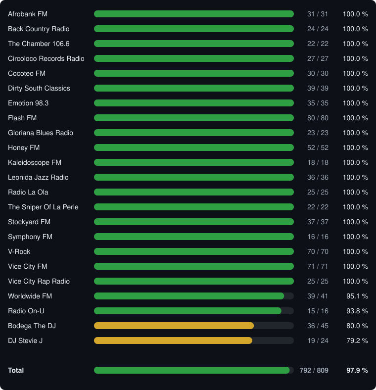

# AWC Radio – station progress

[Deutsche Version](RADIO-PROGRESS.de.md)

How many of the songs that the public credits page lists for each station could be found as files in the game's `audio.rpf`.

**Status: 2026-11-24** · 766 / 813 (94.2 %)

🟢 90 % or more · 🟡 70–89 % · 🟠 30–69 % · 🔴 below 30 %

## Music stations and DJ sets

Table

| Station | Found / listed | Share |
|---|---:|---:|
| 🟢 Afrobank FM | 31 / 31 | 100.0 % |
| 🟢 Back Country Radio | 24 / 24 | 100.0 % |
| 🟢 Circoloco Records Radio | 27 / 27 | 100.0 % |
| 🟢 Radio La Ola | 25 / 25 | 100.0 % |
| 🟢 The Chamber 106.6 | 22 / 22 | 100.0 % |
| 🟢 V-Rock | 70 / 70 | 100.0 % |
| 🟢 Vice City FM | 70 / 71 | 98.6 % |
| 🟢 Flash FM | 78 / 80 | 97.5 % |
| 🟢 Cocoteo FM | 29 / 30 | 96.7 % |
| 🟢 Dirty South Classics | 37 / 39 | 94.9 % |
| 🟢 Stockyard FM | 35 / 37 | 94.6 % |
| 🟢 Kaleidoscope FM | 17 / 18 | 94.4 % |
| 🟢 Honey FM | 49 / 52 | 94.2 % |
| 🟢 Radio On-U | 15 / 16 | 93.8 % |
| 🟢 Emotion 98.3 | 35 / 38 | 92.1 % |
| 🟢 Vice City Rap Radio | 23 / 25 | 92.0 % |
| 🟢 Gloriana Blues Radio | 21 / 23 | 91.3 % |
| 🟢 The Sniper Of La Perle | 20 / 22 | 90.9 % |
| 🟡 Leonida Jazz Radio | 32 / 36 | 88.9 % |
| 🟡 Symphony FM | 15 / 17 | 88.2 % |
| 🟡 Worldwide FM | 36 / 41 | 87.8 % |
| 🟡 Bodega The DJ | 36 / 45 | 80.0 % |
| 🟡 DJ Stevie J | 19 / 24 | 79.2 % |
| **Total** | **766 / 813** | **94.2 %** |

## Station that is one mix

One continuous DJ mix; its songs are not stored as separate files, so they are not counted above.

| Station | Found | Listed songs inside |
|---|---|---:|
| 🎚 The Vault Radio | 1 mix (83 min), plays as the station | 24 |

## Talk radio and shows

The credits list speakers and shows here, not songs, so these numbers say little.

| Station | Found / listed | Share |
|---|---:|---:|
| 🔴 Honey FM - Liquid City | 0 / 8 | 0.0 % |
| 🔴 The Wipe Talk Radio | 0 / 40 | 0.0 % |
| 🔴 WKTT Talk Radio | 0 / 26 | 0.0 % |

## Reading the gaps

- **The Vault Radio** is not in the chart: it is a single long DJ mix without per-song files, so its 24 listed songs cannot be counted as files. The mix itself (83 minutes) is found and played as the station. **Symphony FM** is 15 of 17: its names sit in the game's config with a length byte in front, which is now cut off; the Beethoven piece has no file of its own.
- Titles are matched by their hash first, then by how similar the game's internal name is ("IM_IN_LUV" for "I'm N Luv (Wit a Stripper)"); 64 songs are found this way.
- Long DJ mixes are played as stations: The Vault Radio, and extra "(Mix)" stations for Radio On-U, Worldwide FM and The Sniper Of La Perle. The station of a mix comes from the song markers inside it, or (The Vault) from the folder order in the archive. While a mix plays, the title of the current part is shown (20 of 22, 27 of 41 and 10 of 24 parts have a name). The remaining long mixes (club and DJ-venue music) are played together as the station "Clubmixes" until they can be assigned to a station.
- The other stations lack a few songs each (different spelling or no file of their own).

## How it is measured

- The credits page gives every station's songs. Each title is hashed (`joaat`, the way the game names its streams) and compared with the stream IDs found in the archive scan.
- A song counts as *found* when one stream has exactly that ID, or when the game's internal name of an otherwise unmatched stream is clearly the best match for it. Songs that are not stored as a file of their own count as missing.
- Only counts of public credits entries are shown; no game data and no song files are part of this repository.
