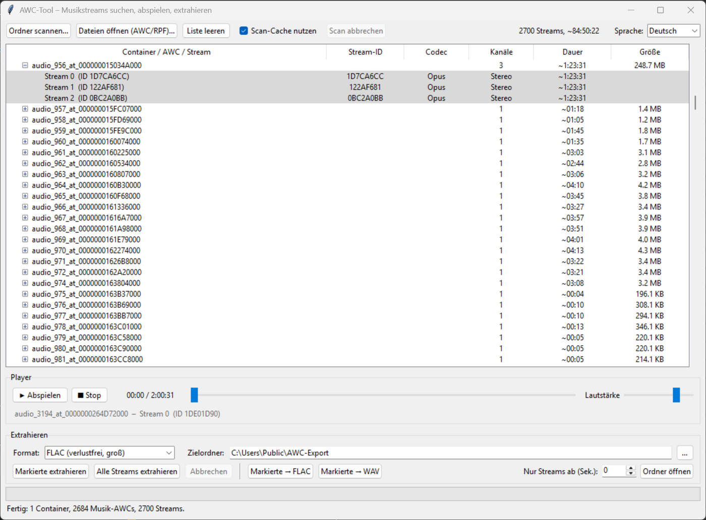
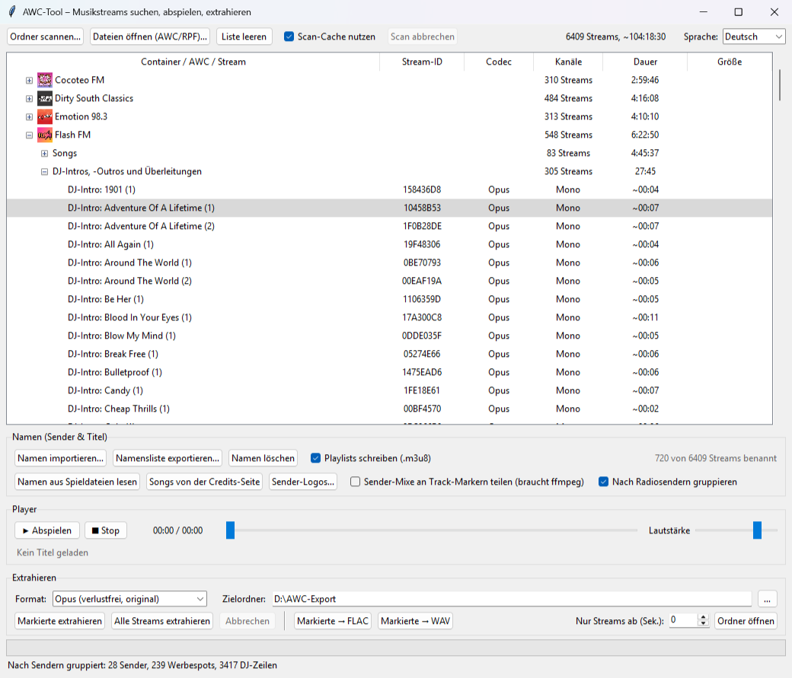
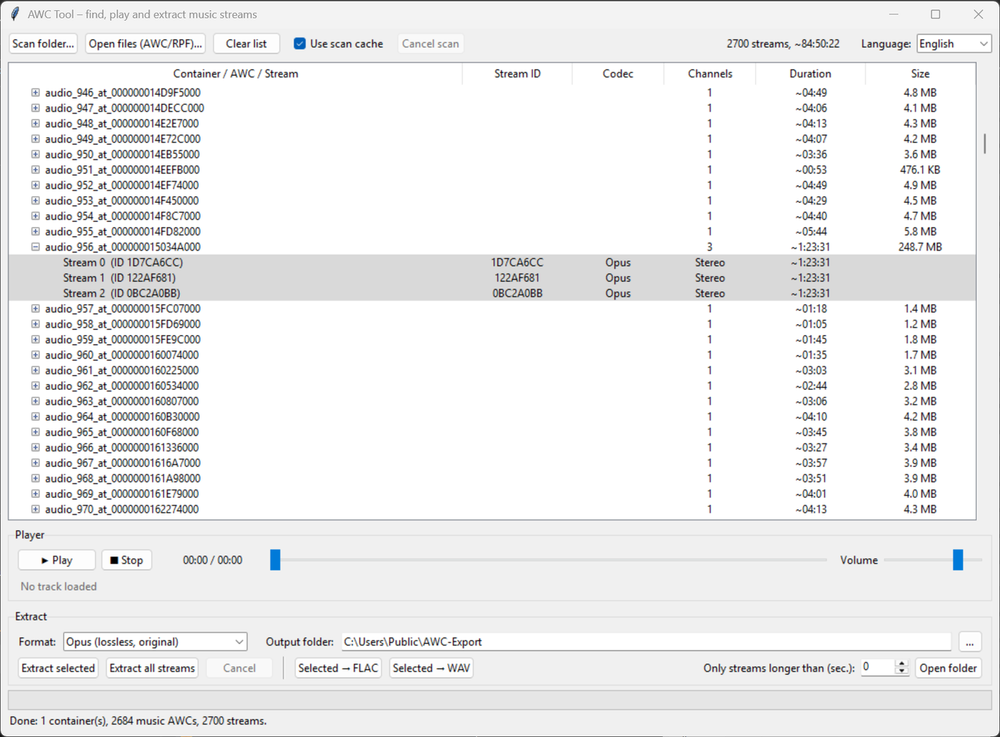
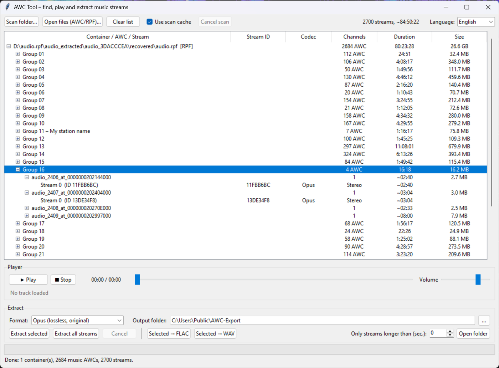
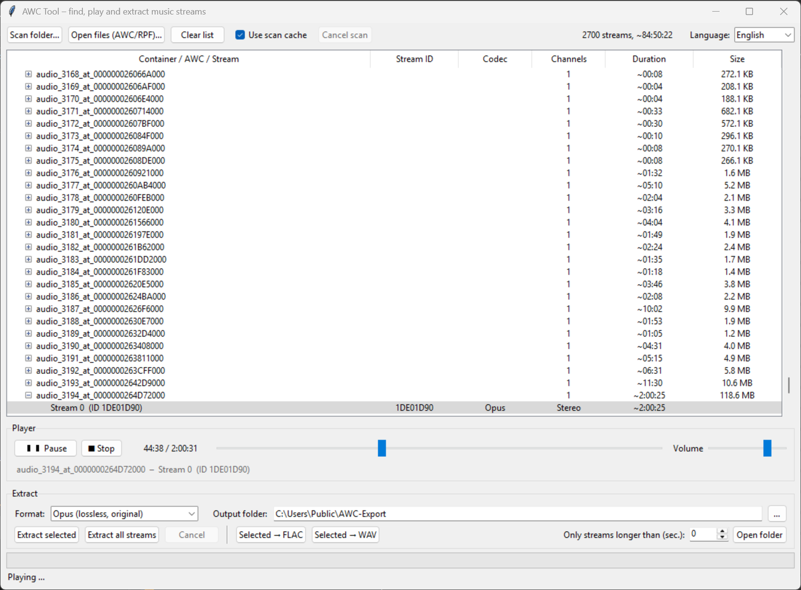
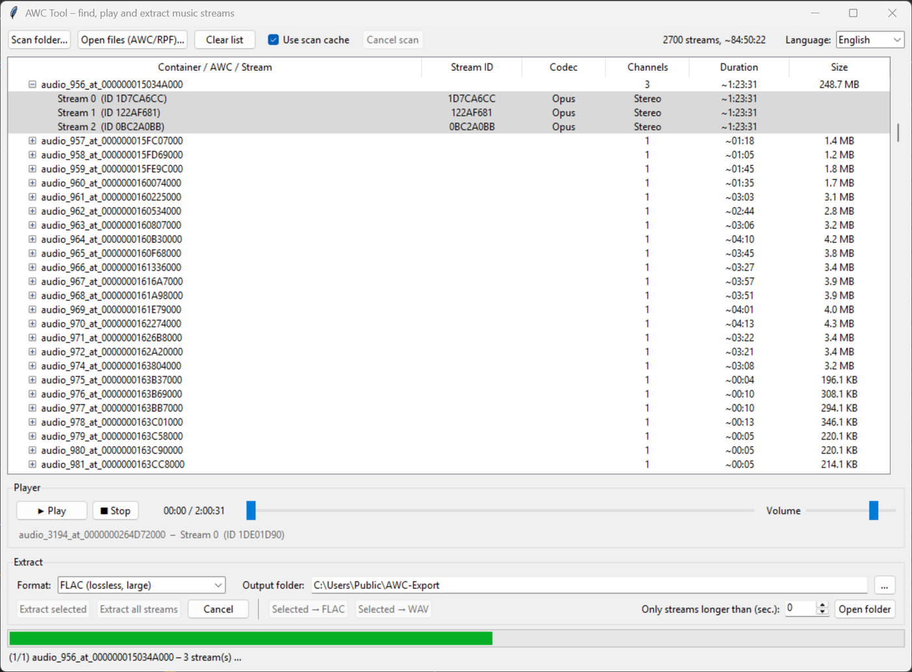
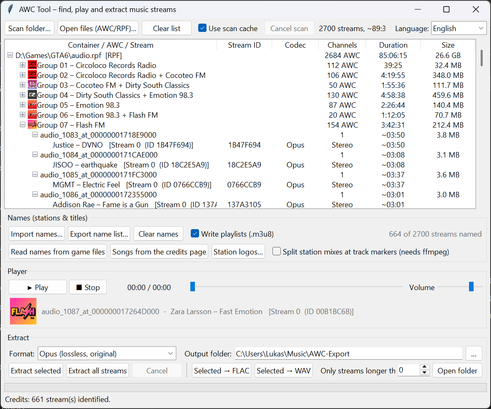

# AWC Audio Extractor

**Musik-Streams aus RAGE-Engine-`.rpf`-Archiven (RPF9) und `.awc`-Dateien finden, abspielen und extrahieren – mit einfacher GUI.**

[← Projektübersicht](../README.de.md) · 🇬🇧 [English version](README.md) · 📄 [Technische Format-Notizen (englisch)](docs/FORMAT.md) · ⬇️ [**Download (Releases)**](https://github.com/Albotterin/AWC_from_RPF9_Extractor/releases/latest) · 📻 [AWC Radio](../radio/README.de.md)



---

## Inhalt

1. [Was macht das Tool?](#was-macht-das-tool)
2. [Rechtlicher Hinweis](#rechtlicher-hinweis)
3. [Funktionen](#funktionen)
4. [Screenshots](#screenshots)
5. [Voraussetzungen & Installation](#voraussetzungen--installation)
6. [Bedienung](#bedienung)
7. [Ausgabeformate und Dateinamen](#ausgabeformate-und-dateinamen)
8. [So funktioniert es](#so-funktioniert-es)
9. [Gruppierung: was gehört zusammen?](#gruppierung-was-gehört-zusammen)
10. [Als Bibliothek nutzen](#als-bibliothek-nutzen)
11. [Eigene `.exe` bauen](#eigene-exe-bauen)
12. [Sprachen](#sprachen)
13. [Einschränkungen](#einschränkungen)
14. [Fehlerbehebung](#fehlerbehebung)
15. [Lizenz & Credits](#lizenz--credits)

---

## Was macht das Tool?

Spiele auf Basis der RAGE-Engine von Rockstar speichern ihr Audio in großen `audio.rpf`-Archiven. Die Musik liegt
darin in **AWC**-Containern (Header `ADAT`). Die neueren **RPF9**-Archive lassen sich mit den üblichen RPF7-Tools nicht
öffnen, und ihr Inhaltsverzeichnis ist nicht lesbar – die AWC-Dateien kann man also nicht einfach über Namen finden.

Dieses Tool geht einen anderen Weg:

1. **Es durchsucht das rohe Archiv nach AWC-Headern** (`ADAT`) – ohne Inhaltsverzeichnis. Ein 28-GB-Archiv dauert
   auf einer normalen Festplatte etwa 6 Minuten; das Ergebnis wird zwischengespeichert, der nächste Scan ist sofort fertig.
2. **Es erkennt die Musik-Container** (Mehrkanal-AWC mit Stream-Format-Chunk) und liest Stream-IDs, Codec,
   Kanal-Aufbau und Dauer.
3. **Es entschlüsselt das Container-Layout** (Blöcke → Kanal-Einträge → Opus-Pakete) und **schreibt die originalen
   Opus-Pakete 1:1 in normale Ogg-Opus-Dateien** – es gibt *keine Neukodierung*, das Audio ist also bitgleich zu dem,
   was das Spiel abspielt.
4. Optional **konvertiert es nach FLAC, WAV oder MP3** (mit ffmpeg) und kann **jeden Stream direkt abspielen**,
   mit Vor-/Zurückspulen und Lautstärkeregler.
5. Da das Inhaltsverzeichnis des Archivs (und damit jeder Dateiname) nicht lesbar ist, **gruppiert es die AWCs nach
   ihrer Lage im Archiv** – Dateien eines Ordners liegen hintereinander, eine Gruppe ist also typischerweise ein
   Radiosender bzw. ein Ordner. Die **Gruppen kannst du selbst benennen** (Rechtsklick); der Name wird zum Ordnernamen
   beim Export.
6. Es kann ein Archiv auch **nach Radiosendern** zeigen: Die Sender werden aus der Audio-Konfiguration des Spiels
   gelesen, jeder mit Logo und mit seinen Songs, **DJ-Intros und -Outros**, **Werbespots**, Jingles und Wortbeiträgen.

Du kannst eine einzelne `.awc`, eine `.rpf` oder einen **ganzen Ordner** angeben – dann werden alle Unterordner nach
`.rpf`- und `.awc`-Dateien durchsucht und alle gefundenen Musik-Streams aufgelistet.

> Beispiel: 28,5-GB-`audio.rpf` → 6.636 AWC-Header, davon 2.968 Musik-Container mit 2.992 Streams
> (Opus, 48 kHz) ≈ 96 Stunden Audio ≈ 5 GB als `.opus`.

## Rechtlicher Hinweis

**Bitte lies den ausführlichen [Disclaimer](../DISCLAIMER.de.md).** Kurz gesagt:

* Dieses Repository enthält **nur Quellcode und Dokumentation**. Es enthält **keine Spieldateien, keine Archive und
  keine extrahierten Audiodaten** – und wird das auch nie.
* Du brauchst deine eigenen Dateien aus einem Spiel, das du rechtmäßig besitzt. Für extrahiertes Audio bist du selbst
  verantwortlich – es unterliegt dem Urheberrecht der Rechteinhaber. Private, nicht-kommerzielle Analyse und
  Archivierung ist eine Sache, die Weitergabe in der Regel nicht erlaubt.
* Das Projekt steht in **keiner Verbindung** zu Rockstar Games, Take-Two oder anderen Publishern und wird von
  diesen nicht unterstützt. Alle Marken gehören ihren jeweiligen Inhabern.

## Funktionen

* 🔍 **Archiv-Scan** per Header-Suche in `.rpf`-Dateien beliebiger Größe (64-MiB-Blöcke, strenge Prüfung).
* 📂 **Ordner-Modus**: alle Unterordner nach `*.rpf` und `*.awc` durchsuchen.
* 🌳 **Baumansicht** Container → Gruppe → AWC → Stream mit Stream-ID, Codec, Stereo/Mono, Dauer und Größe.
* 🗂 **Gruppen**: AWCs werden nach ihrer Lage im Archiv gebündelt (≈ ein Ordner / Radiosender). Rechtsklick auf eine Gruppe → **Gruppe umbenennen…**; der Name wird für den Export-Ordner genutzt.
* 📻 **Ansicht nach Radiosendern**: Sender → Kategorie → Stream, mit Senderlogo: Songs, DJ-Sets, DJ-Intros/-Outros und Überleitungen, Werbung, Jingles, DJ-Ansagen, Musikbetten, Talk-Sendungen; dazu eine Gruppe mit den Podcasts. Beim Extrahieren ein Ordner je Sender und Kategorie.
* ▶️ **Player** direkt aus dem Archiv (Play/Pause/Stop, Positionsleiste, Lautstärke) über `ffplay`.
* 💾 **Extraktion** als Opus (verlustfrei), FLAC, WAV (16 Bit) oder MP3 (320 kbit/s) – für Streams, ganze AWCs oder Container.
* ⏱ **Dauer-Filter** („Nur Streams ab N Sekunden“) blendet die vielen Kurz-Schnipsel aus.
* 🛡 **Sicherheitsnetz**: geschätzte Ausgabegröße, Warnung bei zu wenig Speicher, Rückfrage bei großen Jobs.
* ⚡ **Schnell**: Ogg-Muxer in reinem Python mit zlib-basierter Prüfsumme (~100 MB Opus in etwa einer Sekunde).
* 🧠 **Scan-Cache** in `%APPDATA%\AWC-Tool\cache` (abschaltbar).
* 🌍 **Mehrsprachige Oberfläche** (Englisch/Deutsch), zur Laufzeit umschaltbar und leicht erweiterbar.
* ❌ Scans und Extraktionen sind **abbrechbar**; angefangene Dateien werden entfernt.

## Screenshots

**Nach Radiosendern** – die Sender des Spiels mit ihren Logos; hier die DJ-Intros eines Senders, benannt nach dem Song,
den sie ankündigen.



**Musik-Container eines Archivs durchsuchen** – Mehrstream-AWCs (hier 3 Stereo-Streams) lassen sich aufklappen:



**Gruppen** – ohne lesbares Inhaltsverzeichnis bündelt das Tool die AWCs nach ihrer Lage im Archiv. Jede *Gruppe NN* ist
typischerweise ein Ordner bzw. Radiosender. Rechtsklick → Name vergeben (hier: „My station name“; der Name wird nur auf
deinem PC gespeichert und für den Export-Ordner verwendet):



**Direkt aus dem Archiv abspielen** (hier bei 44:38 eines zweistündigen Streams):



**Extraktion läuft** (FLAC) mit Fortschrittsbalken und *Abbrechen*-Button:



**Sprachumschaltung** – dasselbe Fenster auf Deutsch:


**Benannte Sender** – nach *Songs von der Credits-Seite* heißt jede Gruppe wie ihr Radiosender und bekommt dessen Logo
(Zeilen und Player); Titel, Interpreten und Sender sind für die erkannten Streams eingetragen.



*Die Screenshots zeigen Senderlogos und Songtitel aus dem Spiel; sie illustrieren nur, was das Tool aus deinen eigenen
Spieldateien liest. Vom Spiel wird nichts mitgeliefert.*

## Voraussetzungen & Installation

* **Windows** (GUI und `.exe` zielen auf Windows; die Kernmodule sind reines, portables Python).
* **Python 3 mit tkinter** (im Standard-Installer von python.org enthalten; entwickelt und getestet mit 3.14). Keine `pip`-Pakete nötig, außer **Pillow** (`pip install pillow`) für die optionalen Sender-Logos.
* **ffmpeg + ffplay** – nur für *Abspielen* und den Export nach *FLAC/WAV/MP3*. Opus-Extraktion geht auch ohne.
  ffmpeg gibt es unter <https://ffmpeg.org/download.html>; `ffmpeg.exe` und `ffplay.exe` **neben das Programm** oder in den `PATH` legen.

```bash
git clone https://github.com/Albotterin/AWC_from_RPF9_Extractor.git
cd AWC_from_RPF9_Extractor/extractor
python awc_tool.py
```

Unter Windows geht auch ein Doppelklick auf `Start AWC-Tool.bat` in diesem Ordner – oder `AWC-Tool.exe` aus dem
[Release-Zip](https://github.com/Albotterin/AWC_from_RPF9_Extractor/releases/latest) nehmen (ohne Python).

## Bedienung

1. **Ordner scannen…** klicken und einen Ordner mit `.rpf`/`.awc`-Dateien wählen (Unterordner inklusive) – oder
   **Dateien öffnen (AWC/RPF)…** für einzelne Dateien. Pfade können auch auf der Kommandozeile übergeben werden:
   ```bash
   python awc_tool.py "D:\spiel\audio.rpf"
   python awc_tool.py "D:\spiel"          # ganzer Ordner
   python awc_tool.py --lang=de           # auf Deutsch starten
   ```
2. Scan abwarten. Der Balken zeigt, wie viel vom Archiv gelesen wurde und wie viele Musik-AWCs bisher gefunden wurden.
3. Im Baum **stöbern**. Doppelklick auf einen Stream **spielt** ihn ab (beim ersten Mal wird er kurz in einen
   temporären Cache extrahiert – etwa eine Sekunde pro 100 MB).
4. **Extrahieren**: Streams, AWCs oder einen ganzen Container markieren (Strg/Umschalt für Mehrfachauswahl), **Format**
   und **Zielordner** wählen und **Markierte extrahieren** klicken. **Alle Streams extrahieren** verarbeitet die ganze
   Liste. *Markierte → FLAC* / *→ WAV* sind Ein-Klick-Abkürzungen.
5. Mit **Nur Streams ab (Sek.)** lassen sich kurze Schnipsel überspringen (z. B. `60` = nur Streams ab einer Minute).
### Ansicht nach Radiosendern

**Nach Radiosendern gruppieren** ist von Haus aus angehakt. Nach dem Scan liest das Tool die Sender aus der
Audio-Konfiguration am Anfang des Archivs und sucht die DJ-Ansagen zwischen den Musik-Banken (dauert einige Sekunden
länger). Ohne Haken erscheint wieder die Ansicht nach Lage im Archiv.

* Jeder Sender hat Ordner für **Songs**, **DJ-Set**, **DJ-Intros, -Outros und Überleitungen**, **Werbung**,
  **Senderkennungen und Jingles**, **DJ-Ansagen**, **Sendungs-An- und -Abmoderationen**, **Musikbetten**,
  **Wortbeiträge und Nachrichten** und **Sonstiges** (nur die, die er hat).
* Die **DJ-Intros und -Outros** sind Sprachaufnahmen in Mono; sie erscheinen nur in dieser Ansicht. Eine Zeile bekommt den
  Namen ihres Songs, wo die Stream-ID zum Namensschema des Spiels passt; die übrigen sind nummeriert.
* **Werbespots** teilen sich die Sender; sie sind einmal für das ganze Archiv nummeriert (`Werbung 001`, …). Die
  Konfiguration enthält keine Produktnamen. Rechtsklick → **Titel / Interpret setzen…** benennt einen Spot, oder man
  trägt Namen in `%APPDATA%\AWC-Tool\advert_names.json` ein: `{"<Stream-ID, hex>": "<Name>"}`.
* Die **Podcasts** stehen in einer eigenen Gruppe **Podcasts**, je Podcast mit Cover und seinen Folgen; beim Extrahieren
  entstehen die Ordner `Podcasts/<Name>/`.
* Was die Konfiguration keinem Sender zuordnet, steht nach Lage unter **Keinem Sender zugeordnet**.

### Namen, Logos und Mixe

6. **Gruppen benennen** (optional): Rechtsklick auf eine Zeile *Gruppe NN* → **Gruppe umbenennen…** (z. B. nach dem
   Reinhören). Die Namen liegen in `%APPDATA%\AWC-Tool\group_names.json` und werden Teil des Export-Ordnernamens.
7. **Namen** (optional) – die AWC-Dateien enthalten nur 32-Bit-Hash-IDs, keine Namen:
   * **Namen aus Spieldateien lesen** hasht die internen Namen aus der Audio-Konfiguration des Spiels (der
     zlib-Teil am Anfang der `audio.rpf`) und trägt Titel für die erkannten Streams ein (im Beispielarchiv etwa ein
     Drittel der Musik-Streams; nur interne Titel, keine Interpreten). Die dort gefundenen Stationsnamen werden
     bei **Gruppe umbenennen…** vorgeschlagen.
   * **Songs von der Credits-Seite** lädt die Soundtrack-Liste der öffentlichen Credits-Seite des Herausgebers
     (`rockstargames.com/VI/credits`: jeder Sender mit seinen Songs und Interpreten), hasht die Titel wie das Spiel
     und setzt für jeden erkannten Stream **Titel, Interpret und Sender** (im Beispielarchiv etwa 660 der
     Musik-Streams; die meisten Sender werden fast vollständig getroffen). Der Sender wird pro Track gespeichert
     und für Tags, Playlists und als Vorschlag bei **Gruppe umbenennen…** genutzt. Schlägt der Download fehl, kann
     die im Browser gespeicherte Seite gewählt werden. Die Liste wird nicht mitgeliefert und bleibt auf deinem PC.
     Die Gruppen werden danach automatisch **nach ihrem Sender benannt** (die Sender liegen im Archiv hintereinander;
     eine Gruppe über zwei Sender heißt `A + B`). Selbst vergebene Namen werden nie überschrieben, und Tracks ohne
     Titel übernehmen für Tags und Playlists den Sender ihrer Nachbarn.
   * **Namen importieren…** liest eine CSV/TXT/JSON-Liste (nach Stream-ID oder internem Namen), **Namensliste
     exportieren…** schreibt eine Vorlage zum Ausfüllen, Rechtsklick → **Titel / Interpret setzen…** benennt einen
     einzelnen Stream.
   * Benannte Streams bekommen beim Export `Interpret - Titel` als Dateinamen und Opus/FLAC/MP3-Tags, optional
     `.m3u8`-Playlists. Die Namen bleiben auf deinem PC (`%APPDATA%\AWC-Tool\track_names.json`), das Tool liefert
     keine mit.
8. **Sender-Logos** (optional): beim Abspielen wird das Logo des Radiosenders angezeigt. Die Logos werden aus dem
   UI-Textur-Pool des Spiels (`data\ttdb\ui\ttdb_ui.ttpf`, neben der `audio.rpf`) nach `%APPDATA%\AWC-Tool\icons\`
   geschnitten. Der kleine Leser `awc_logos.py` kann genau diese Texturen (BC1 / BC7 in zlib-Blöcken, nichts wird
   entschlüsselt), es muss also nichts heruntergeladen werden. Das passiert nach einem Scan; der Knopf **Sender-Logos…**
   wiederholt den Schritt. Die Logos werden in voller Spielgröße (256 × 256) gespeichert. Bekannt sind 32 Logos und Podcast-Cover; den
   Sender liefert die Credits-Liste (siehe Punkt 7). Gruppen-Zeilen bekommen ein kleines Logo, und FLAC/MP3-Exporte
   tragen das Logo als Cover-Bild. Vom Spiel wird nichts mitgeliefert.
9. **Sender-Mixe** (optional): ein paar sehr lange Streams (40-120 Min.) sind komplette Radio-Mixe. Das Spiel legt
   für jeden gespielten Track einen `trackid`-Marker ab; das Tool zeigt sie als Kapitel unter dem Stream (Doppelklick
   spielt ab dort) und benennt sie, wenn der passende Einzel-Track einen Titel hat. Mit **Sender-Mixe an
   Track-Markern teilen** wird jedes Kapitel zusätzlich als eigene Datei in einem Ordner `... (tracks)`
   geschrieben (braucht ffmpeg; der Schnitt ist eine Stream-Kopie, markergenau). Die Bedeutung der Marker ist
   erschlossen, siehe `docs/FORMAT.md`.

Kommandozeile: `python awc_tool.py [--lang=en|de] [Ordner | datei.awc | datei.rpf ...]`

## Ausgabeformate und Dateinamen

| Format | Größe (Stereo, pro Stunde) | Hinweis |
|---|---|---|
| **Opus** | ≈ 58 MB | Originalpakete im Ogg-Container – **bitgleiches Audio, keine Neukodierung**. |
| FLAC | ≈ 600 MB | Verlustfreie Kopie des *dekodierten* Audios (die Quelle ist verlustbehaftetes Opus). |
| WAV | ≈ 700 MB | 16 Bit PCM, 48 kHz. Sehr groß. |
| MP3 | ≈ 140 MB | 320 kbit/s, aus dem dekodierten Audio neu kodiert. |

> Die Quelle ist verlustbehaftet (Opus, 128 kbit/s Stereo). FLAC/WAV verbessern die Qualität nicht – sie dienen der
> Kompatibilität mit Programmen, die kein Opus lesen können.

Dateiname: `<Zielordner>/<Container>/<Gruppenordner>/<awc-name>_stream<N>_<STREAMID>.<ext>`, z. B.
`AWC-Export/audio/group_04/audio_956_at_000000015034A000_stream0_1D7CA6CC.opus` (nach dem Benennen der Gruppe z. B.
`group_04_Mein Sender/…`) – `group_04` ist die Gruppe (siehe [Gruppierung](#gruppierung-was-gehört-zusammen)), `956` die laufende Nummer des AWC-Headers,
`000000015034A000` der Byte-Offset im Archiv, `1D7CA6CC` die 32-Bit-Stream-ID (ein Hash; echte Namen stehen nicht in der AWC).

In der **Ansicht nach Radiosendern** heißen die Ordner `<Zielordner>/<Container>/<Sender>/<Kategorie>/`, die Dateien wie
in der Ansicht (`Interpret - Titel`, `DJ-Intro - Song (1)`, `Werbung 001`). Ein Spot, den mehrere ausgewählte Sender
spielen, wird in jeden ihrer Ordner geschrieben.

## So funktioniert es

```
audio.rpf (28 GB)
  └─ Suche nach "ADAT" ──► Kandidaten ──► strenge Header-Prüfung ──► AWC bei Offset X, Länge L
        └─ Chunk-Tabelle: 0x48 Stream-Format · 0x55 Daten · 0xA3 Seek-Tabelle · 0xBD Events
              └─ Daten = Blöcke à 512 KiB
                    └─ Block: Kanal-Tabelle · Seek-Tabellen · 0x800-Byte-Einheiten [u16 Länge | Opus-Paket]*
                          └─ Opus-Pakete ──► Ogg-Seiten (OpusHead/OpusTags + CRC) ──► .opus
                                                  └─ ffmpeg ──► FLAC / WAV / MP3
```

Die Byte-genaue Beschreibung steht in **[docs/FORMAT.md](docs/FORMAT.md)** (englisch).
Die DJ-Ansagen liegen in AWCs mit anderem Aufbau (viele kurze Zeilen je Datei); `awc_speech.py` liest sie für die
Ansicht nach Sendern ([FORMAT.md, Abschnitt 8](docs/FORMAT.md#8-speech-containers-dj-lines)).

## Gruppierung: was gehört zusammen?

Das RPF9-Inhaltsverzeichnis ist nicht lesbar, das Archiv verrät also nicht, welche AWC zu welchem Sender oder Ordner
gehört. Das Tool nutzt deshalb eine **Heuristik über die physische Anordnung**:

* Dateien eines Ordners liegen **direkt hintereinander**; zwischen zwei Ordnern gibt es meist eine größere Lücke (und
  eine Nicht-Musik-AWC). Eine neue Gruppe beginnt, wenn die Lücke zur vorigen Musik-AWC **≥ 64 KiB** ist oder die
  laufende AWC-Nummer springt (= dazwischen liegt eine Nicht-Musik-AWC).
* Im Beispiel-Archiv ergab das **47 Gruppen**.
* Typischer Inhalt: Songs (3–5 Min.), viele kurze Sprach-/Jingle-Schnipsel und manchmal ein 1–2-stündiger
  Dauerstream. Gruppen mit nur sehr kurzen Schnipseln sind vermutlich gar kein Radio.

**Was es nicht kann:** sagen, welcher Sender eine Gruppe ist (das Tool schlägt nur die in der Spiel-Konfiguration gefundenen
Sendernamen vor). Eine Gruppe ist *wahrscheinlich* ein Ordner,
aber das ist ein Schluss, keine Tatsache. Ein paar Titel anhören, dann die Gruppen im Tool benennen.
Praktisch: `Nur Streams ab (Sek.)` mit `90` behält nur die echten Titel.

Im Code: `awc_core.add_groups(items)` setzt `item["g"]` (ab 1) auf den Einträgen des Scanners.

Wo die Radio-Konfiguration des Spiels lesbar ist, kommt die [Ansicht nach Radiosendern](#ansicht-nach-radiosendern)
ohne Raten aus.

## Als Bibliothek nutzen

```python
import awc_core as core

items, total_awc, from_cache = core.scan_container_cached(r"D:\spiel\audio.rpf")
ref = core.AwcRef(items[0])
jobs = {s.index: f"out_{s.index}_{s.id:08X}.opus" for s in ref.streams if s.supported}
seconds = ref.extract(jobs, progress=lambda f: print(f"{f:.0%}"))
```

## Eigene `.exe` bauen

```bat
build_exe.bat
```

In diesem Ordner ausführen. Installiert bei Bedarf PyInstaller und erzeugt `dist\AWC-Tool.exe`. `ffmpeg.exe` und `ffplay.exe` daneben legen.
(Die `.exe` und ffmpeg sind bewusst **nicht** Teil dieses Repositories. PyInstaller-Programme werden von Virenscannern
manchmal fälschlich gemeldet – im Zweifel aus dem Quellcode starten.)

## Sprachen

Die Oberfläche lässt sich jederzeit über das Feld **Sprache** (oben rechts) umschalten; die Wahl wird in
`%APPDATA%\AWC-Tool\settings.json` gespeichert. Aktuell: **English** (Standard) und **Deutsch**. Weitere Sprachen:
in `awc_i18n.py` einen Eintrag in `LANGUAGES` und eine Tabelle in `STRINGS` ergänzen (fehlende Schlüssel fallen auf
Englisch zurück). Pull Requests mit Übersetzungen sind willkommen.

## Einschränkungen

* **Nur Opus (`0x0B`)**: die Musik-Container und in der Ansicht nach Sendern die DJ-Sprachcontainer des Radios. Andere
  AWC-Arten (Effekte, sonstige Sprache, Vorbis/ADPCM/XMA …) werden übersprungen.
* **Werbespots haben keine Produktnamen** und manche DJ-Zeilen keinen erkannten Namen: Weder die AWCs noch die
  Radio-Konfiguration enthalten sie.
* Die Ansicht nach Sendern hängt an der Radio-Konfiguration des Spiels; entwickelt wurde sie mit einem Archiv.
* Das **RPF9-Inhaltsverzeichnis wird nicht gelesen** (es wirkt verschlüsselt/verschleiert) – deshalb gibt es **keine
  echten Dateinamen**, nur Offsets und Stream-IDs.
* **Gruppen sind eine Layout-Heuristik** (siehe oben), keine echten Ordner; Namen musst du selbst vergeben.
* Entwickelt und getestet mit den AWC-Dateien **eines** RPF9-Archivs; andere Spiele/Versionen können abweichen.
* Dauern in der Liste (mit `~`) stammen aus der Sample-Zahl im Stream-Header. Im Beispielarchiv stimmten sie bei 2236
  von 2240 Streams auf 1 % genau mit den Längen aus der Audio-Konfiguration des Spiels überein; die genaue Länge steht
  nach Extraktion/Wiedergabe fest.
* Beim Spulen startet `ffplay` an der neuen Stelle neu (kurze Lücke ist normal).

## Fehlerbehebung

| Problem | Lösung |
|---|---|
| Warnung „ffmpeg fehlt“ | `ffmpeg.exe` und `ffplay.exe` neben das Programm oder in den `PATH`. Opus-Extraktion geht trotzdem. |
| Scan großer Archive ist langsam | Festplatten-Tempo (≈ 80 MB/s HDD, SSD deutlich schneller). Der zweite Lauf ist dank Cache sofort fertig. |
| Neu scannen | **Scan-Cache nutzen** abwählen (oder `%APPDATA%\AWC-Tool\cache` löschen). |
| „Kein Mehrkanal-Musik-Container“ | Es ist eine andere AWC-Art (Effekte/Sprache) – nicht unterstützt. |
| Zu wenig Speicherplatz | WAV/FLAC sind groß – Opus nehmen oder nach Dauer filtern. |

## Projektaufbau

```
extractor/
  awc_tool.py         Oberfläche (tkinter): Baum, Player, Extraktion, Sprachumschaltung
  awc_core.py         AWC-Parser, RPF-Scanner, Ogg-Opus-Writer (ohne GUI-Abhängigkeiten)
  awc_i18n.py         Übersetzungen (English, Deutsch) + Einstellungen
  awc_names.py        Namensspeicher für Tracks/Sender, Import/Export, Tags, Playlists
  awc_config.py       Liest interne Namen aus der Audio-Konfiguration des Spiels
  awc_credits.py      Liest die öffentliche Credits-Seite und ordnet ihre Songs Stream-IDs zu
  awc_icons.py        Optional: schneidet die Sender-Logos aus dem Spiel
  awc_logos.py        Kleiner Leser für die Logo-Texturen im UI-Textur-Pool des Spiels
  awc_gamedata.py     Liest die Radiosender, ihre Playlists und Kategorien aus der Audio-Konfiguration des Spiels
  awc_speech.py       Liest die DJ-Sprachcontainer (Ansicht nach Radiosendern)
  logos/              Selbst gezeichnete Bilder für Sender, die die Programme selbst bilden (make_station_logos.py)
  Start AWC-Tool.bat  Starter
  build_exe.bat       Baut dist\AWC-Tool.exe mit PyInstaller
  docs/FORMAT.md      Technische Notizen zum AWC/RPF9-Aufbau (englisch)
  docs/screenshots/   Bilder dieser Anleitung
```

Diese Module sind auch die Basis von [AWC Radio](../radio/README.de.md), das sie aus diesem Ordner importiert.

## Lizenz & Credits

[MIT](../LICENSE) – gilt nur für den Quellcode, nicht für Spieldaten.

Das Block-Layout der AWC-Musikstreams wurde anhand des Open-Source-Codes von
[vgmstream](https://github.com/vgmstream/vgmstream) (`awc.c`, `awc_streamfile.h`) und durch Analyse von Beispieldateien
erarbeitet; allgemeines AWC/RPF-Wissen stammt aus der Community, v. a. von
[CodeWalker](https://github.com/dexyfex/CodeWalker). Opus: Xiph.Org/IETF (RFC 6716), Ogg: RFC 3533/7845.
Abspielen und Konvertieren übernimmt [FFmpeg](https://ffmpeg.org/).

Das Layout der Audio-Konfiguration des Spiels (Namensliste, die 29-Bit-Stream-IDs als `joaat`-Hashes) folgt den Notizen
von Leonida (ItsNotRexed; `docs/audio_config.md`, `docs/audio.md`). Die Funde zu den
`0xBD`-Markern in `docs/FORMAT.md` wurden dort zurückgemeldet.
