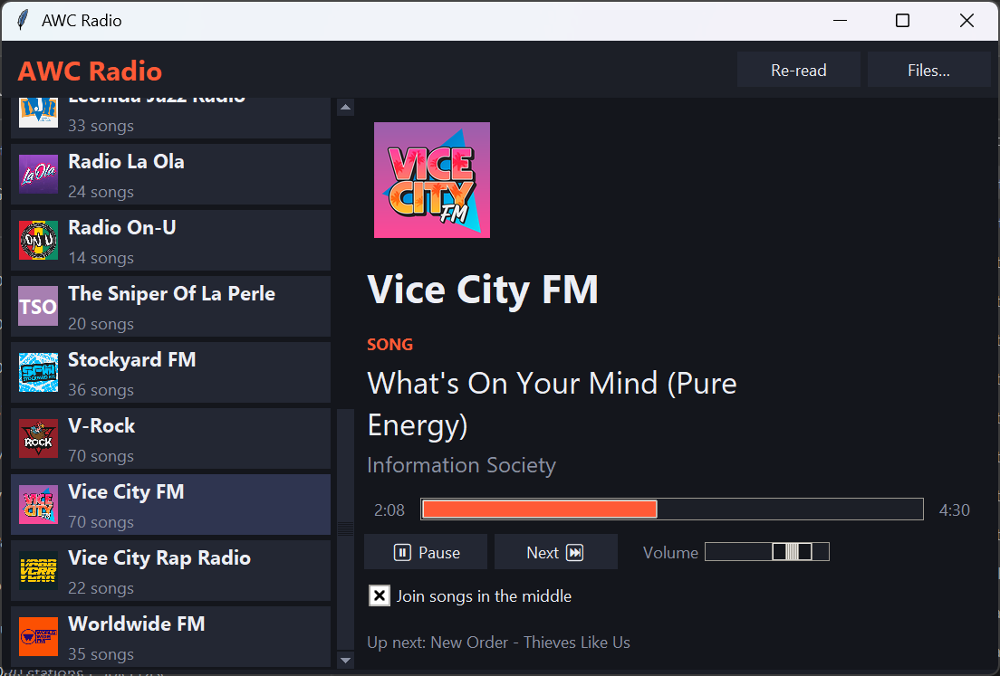
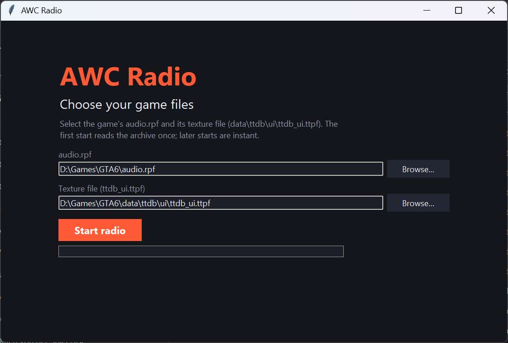
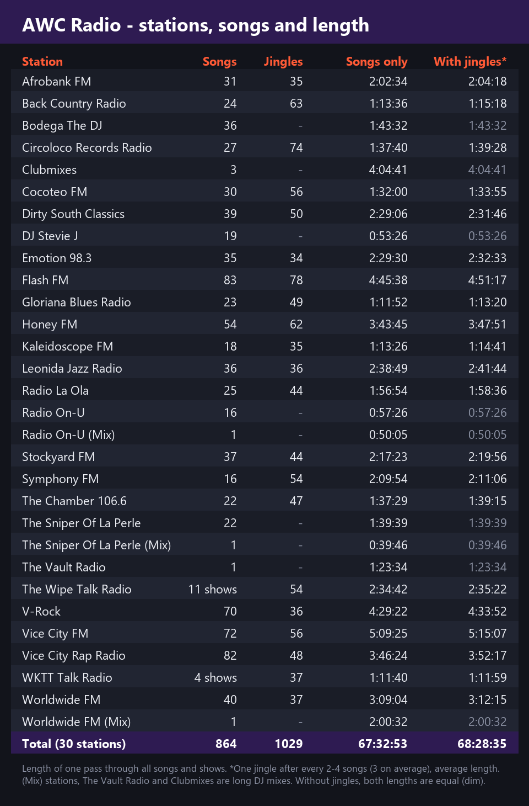

# AWC Radio

**Die Radiosender des Spiels als Live-Webradio – am PC und auf Android.**

[← Projektübersicht](../README.de.md) · 🇬🇧 [English version](README.md) · 📊 [Fortschritt der Sender](docs/RADIO-PROGRESS.de.md) · 📄 [Sender-Notizen (englisch)](docs/STATIONS.md) · ⬇️ [**Download (Releases)**](https://github.com/Albotterin/AWC_from_RPF9_Extractor/releases/latest) · 🎛 [Audio Extractor](../extractor/README.de.md)



---

## Inhalt

1. [Start](#start)
2. [Woher die Sender kommen](#woher-die-sender-kommen)
3. [Hören](#hören)
4. [Sender und Fortschritt](#sender-und-fortschritt)
5. [AWC Radio für Android](#awc-radio-für-android)
6. [Selbst bauen](#selbst-bauen)
7. [Projektaufbau](#projektaufbau)
8. [Rechtlicher Hinweis](#rechtlicher-hinweis)
9. [Credits und Lizenz](#credits-und-lizenz)

## Start

`awc_radio.py` (oder `Start AWC-Radio.bat` / `AWC-Radio.exe`) ist ein kleiner Webradio-Player auf Basis des
[Extractor](../extractor/README.de.md)-Codes. Beim ersten Start wählst du die `audio.rpf` des Spiels und die Textur-Datei (`data\ttdb\ui\ttdb_ui.ttpf`).
Die App liest das Archiv einmal ein (derselbe Scan-Cache wie beim Extractor; beim ersten Mal mehrere Minuten) und
zeigt dann jeden Sender mit seinem Logo.

* **Windows-Programm:** das [Release](https://github.com/Albotterin/AWC_from_RPF9_Extractor/releases/latest) entpacken, `ffplay.exe` neben `AWC-Radio.exe` (oder in den `PATH`) legen und starten.
* **Aus dem Quellcode:** Python 3 mit tkinter, Pillow für die Logos (`pip install pillow`). Die Ordner `radio/` und
  `extractor/` nebeneinander lassen, dann `python radio/awc_radio.py` starten oder `Start AWC-Radio.bat` doppelklicken.



## Woher die Sender kommen

Die Audio-Konfiguration des Spiels (der zlib-Teil am Anfang der `audio.rpf`) beschreibt
jeden Radiosender mit seiner kompletten Playlist samt Titeln und Interpreten. Die Musiksender und die beiden
**Talk-Radio**-Sender (**WKTT** und **The Wipe**) werden direkt daraus gelesen. Die Songliste der öffentlichen
Credits-Seite liefert die Schreibweise der Namen und die Club-DJ-Sets und Mixe, die weiterhin über ihre Namen zugeordnet
werden. Siehe [docs/STATIONS.md](docs/STATIONS.md) (englisch).

## Hören

Ein Klick auf einen Sender schaltet ihn ein: seine Songs laufen nacheinander, nach jeweils 2-4 Songs kommt ein kurzer
Jingle. Beim Talk-Radio ist ein „Titel“ eine ganze Sendungsfolge (ihre Teile am Stück, 10-23 Minuten). Das Programm wird
aus der **UTC-Uhrzeit** berechnet (jeden UTC-Tag eine neue Reihenfolge, Jingles inklusive), jeder Sender „läuft“ also im
Hintergrund weiter: Wer zu einem anderen Sender und zurück wechselt, landet dort, wo der erste Sender inzwischen ist.
Alle mit denselben Spieldateien und derselben Uhrzeit hören denselben Song zur selben Sekunde (auf etwa eine Sekunde
genau; der Song, der über Mitternacht UTC laufen würde, wird abgeschnitten). Aufeinanderfolgende Songs und Jingles werden
3 Sekunden lang **überblendet** (um kurze Jingles herum kürzer), für alle im selben Moment. Es gibt keinen
Überspringen-Knopf – wie bei einem echten Radio; nach einer Pause geht es live weiter. Spätere Starts gehen sofort. Als
**Jingles** dienen die kurzen Aufnahmen (Senderkennungen und DJ-Ansagen), die nur dieser Sender benutzt; bei den
Club-DJ-Sets ist das eine begründete Vermutung. Die Werbung, die sich mehrere Sender teilen, wird nicht gespielt. Braucht
wie der Extractor `ffplay`.

## Sender und Fortschritt

792 von 809 Songs, die die Credits für die Musiksender nennen (97,9 %), sind gefunden, dazu alle 15 Folgen
der Talk-Sendungen; alle Sender in [Fortschritt der Sender](docs/RADIO-PROGRESS.de.md).
Lange DJ-Mixe laufen auch als Sender: **The Vault Radio**, zusätzliche „(Mix)“-Sender für Radio On-U, Worldwide FM und The Sniper Of La Perle sowie **Clubmixes** (die Club- und DJ-Mixe, die noch keinem Sender zugeordnet werden können). Während ein Mix läuft, wird der Titel des aktuellen Abschnitts angezeigt (aus den Markern im Mix; ein Abschnitt hat nur dann einen Namen, wenn der Marker auf einen bekannten Song zeigt).

Alle Zahlen je Sender: [Fortschritt der Sender](docs/RADIO-PROGRESS.de.md).



## AWC Radio für Android

Die Handy-App spielt dasselbe Live-Programm wie der PC: gleiche UTC-Uhr, gleiche Reihenfolge, gleiche Überblendungen.
Es sind zwei Dateien:

* **`AWC-Radio.apk`** - die App, von der [Release-Seite](https://github.com/Albotterin/AWC_from_RPF9_Extractor/releases/latest). Für alle dieselbe Datei, ohne Spieldaten.
  Android 7.0 oder neuer, Deutsch und Englisch. Sie spielt im Hintergrund weiter, mit Medien-Benachrichtigung,
  Sperrbildschirm- und Kopfhörertasten (voriger / nächster Sender, Pause) und hat einen Einschlaftimer. **Android Auto** wird unterstützt: Die Sender erscheinen als Raster mit ihren Logos, der Player-Bildschirm zeigt Song und Sender, und Sprachbefehle („Spiele Radio On-U auf AWC Radio“) funktionieren. Da die App nicht aus dem Play Store kommt, muss in den Entwicklereinstellungen von Android Auto zuerst „Unbekannte Quellen“ aktiviert werden.
* **Ein Sender-Pack (`.dat`)** - wird am PC erzeugt: in AWC Radio auf **Android-Pack...** klicken, Sender ankreuzen und
  speichern. Darin liegen die Songs dieser Sender in der Originalqualität des Spiels (ca. 128 kbit/s, nicht neu kodiert;
  etwa 4 GB für alle 30 Sender), ihre Logos und das Programm. Aufs Handy kopieren, die App starten und die Datei
  einmal auswählen; die Songs werden direkt daraus abgespielt.

Das Pack enthält Spiel-Audio: nur für den eigenen Gebrauch, bitte nicht weitergeben. Ohne Pack ist die App leer.
`python awc_radio.py --export-pack out.dat [--stations "Name" ...]` schreibt ein Pack ohne Fenster. Quelltext und
Build-Skripte der App liegen in `android/`: `python android\build_apk.py <Ordner des Android SDK>` baut die APK
(Android SDK und JDK nötig), `python android\test\run_tests.py` testet am PC.

## Selbst bauen

`build_exe.bat` (in diesem Ordner) installiert bei Bedarf PyInstaller und erzeugt `dist\AWC-Radio.exe`.

## Projektaufbau

```
radio/
  awc_radio.py          Das Radio-Programm (Fenster, Programmplan, Wiedergabe)
  awc_gamedata.py       Liest die Radiosender und ihre Playlists aus der Audio-Konfiguration des Spiels
  awc_android.py        Schreibt das Sender-Pack (.dat) für die Android-App, samt Dialog
  android/              Die Android-App: Java-Quelltext, build_apk.py, make_logo.py, Tests
  Start AWC-Radio.bat   Starter
  build_exe.bat         Baut dist\AWC-Radio.exe mit PyInstaller
  docs/STATIONS.md      Wie die Sender in der Audio-Konfiguration gespeichert sind (englisch)
  docs/RADIO-PROGRESS.de.md  Gefundene Songs und Sendungen je Sender (auch englisch)
  docs/screenshots/     Bilder dieser Anleitung
```

Archiv-Scan, AWC-Leser, Credits-Liste und Logos sind die Module des [Extractor](../extractor/README.de.md).

## Rechtlicher Hinweis

* Dieses Repository enthält **nur Quellcode und Dokumentation**. Es enthält **keine Spieldateien, keine Archive und
  keine extrahierten Audiodaten** – und wird das auch nie.
* Du brauchst deine eigenen Dateien aus einem Spiel, das du rechtmäßig besitzt. Für extrahiertes Audio bist du selbst
  verantwortlich – es unterliegt dem Urheberrecht der Rechteinhaber. Private, nicht-kommerzielle Analyse und
  Archivierung ist eine Sache, die Weitergabe in der Regel nicht erlaubt.
* Das Projekt steht in **keiner Verbindung** zu Rockstar Games, Take-Two oder anderen Publishern und wird von
  diesen nicht unterstützt. Alle Marken gehören ihren jeweiligen Inhabern.

## Credits und Lizenz

Das Layout der Audio-Konfiguration folgt den Notizen von [**Leonida**](https://github.com/ItsNotRexed/Leonida); dessen
Texturdecoder wird für die optionalen Sender-Logos genutzt. Das Startbild-Symbol der Android-App wurde mit der
Fan-Schrift *GTA Art Deco* gezeichnet (nicht Teil dieses Repositorys). Die Wiedergabe übernimmt
[FFmpeg](https://ffmpeg.org/).

[MIT](../LICENSE) – gilt nur für den Quellcode, nicht für Spieldaten.
