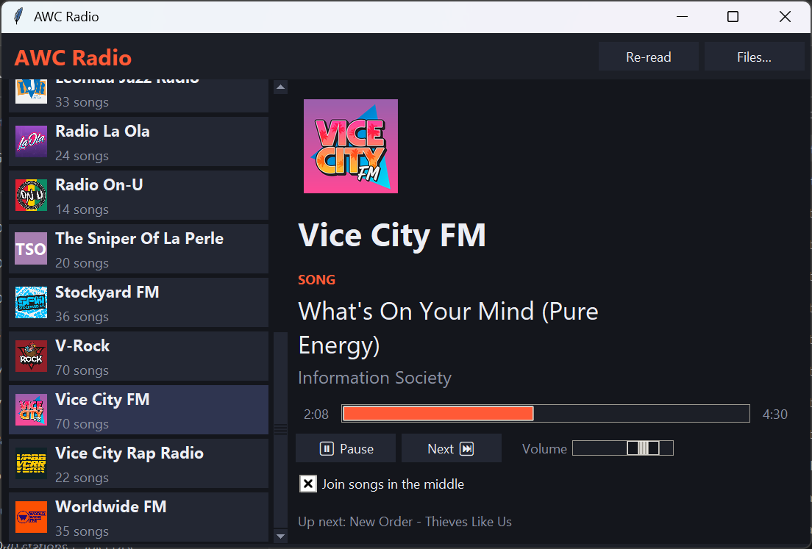
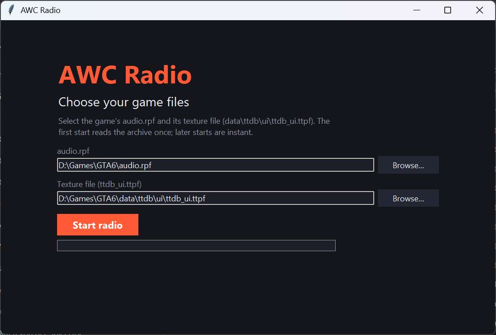
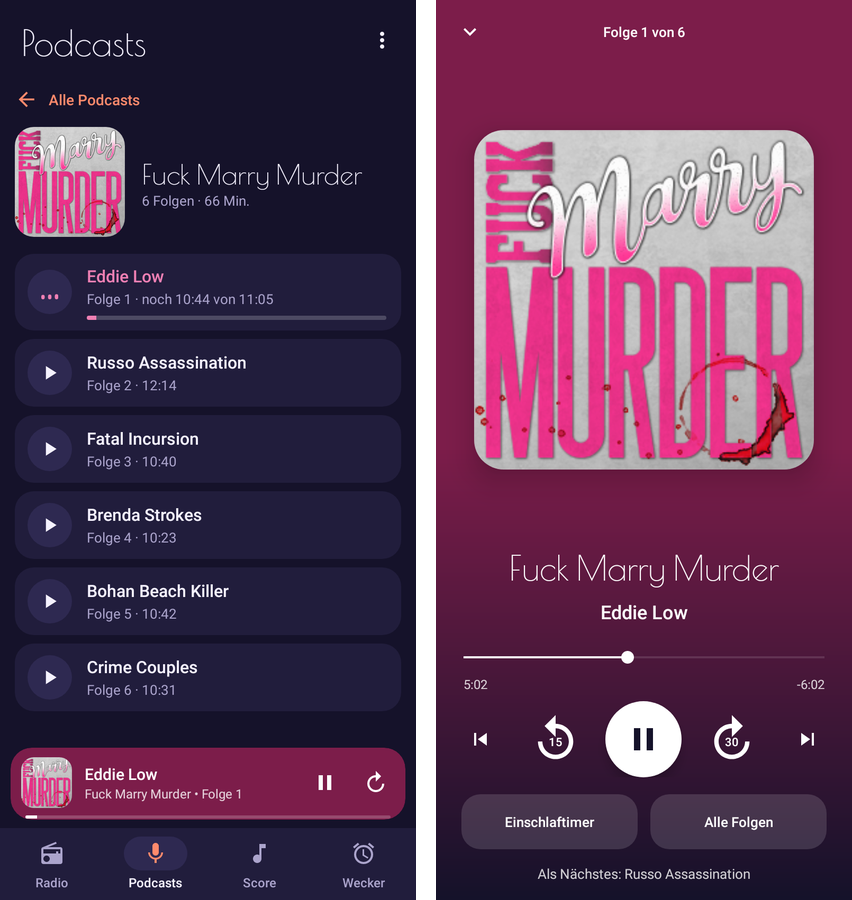
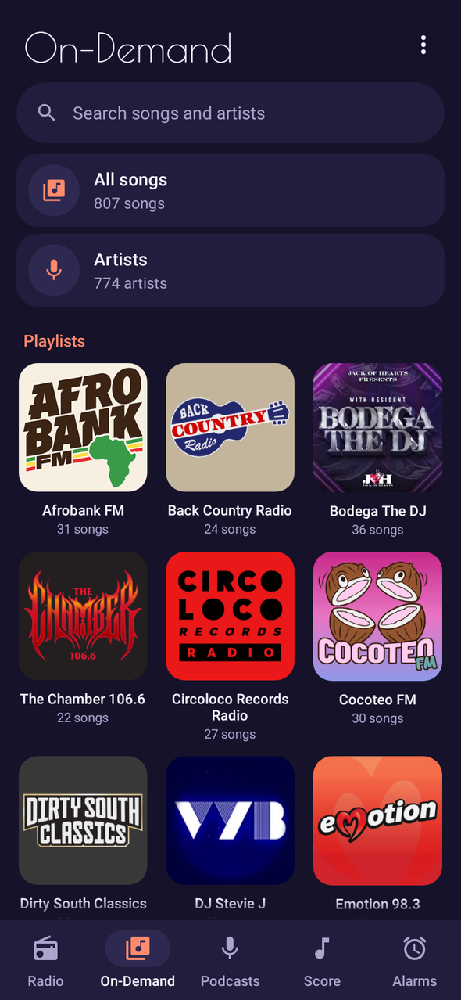

# AWC Radio

**The game's radio stations as a live web radio – on the PC and on Android.**

[← Project overview](../README.md) · 🇩🇪 [Deutsche Version](README.de.md) · 📊 [Station progress](docs/RADIO-PROGRESS.md) · 📄 [Station notes](docs/STATIONS.md) · ⬇️ [**Download (Releases)**](https://github.com/Albotterin/AWC_from_RPF9_Extractor/releases/latest) · 🎛 [Audio Extractor](../extractor/README.md)



---

## Table of contents

1. [Start](#start)
2. [Where the stations come from](#where-the-stations-come-from)
3. [Listening](#listening)
4. [Podcasts](#podcasts)
5. [On-Demand](#on-demand)
6. [Stations and progress](#stations-and-progress)
7. [AWC Radio for Android](#awc-radio-for-android)
8. [Building](#building)
9. [Project layout](#project-layout)
10. [Legal notice](#legal-notice)
11. [Credits and license](#credits-and-license)

## Start

`awc_radio.py` (or `Start AWC-Radio.bat` / `AWC-Radio.exe`) is a small web-radio style player on top of the
[extractor](../extractor/README.md)'s code. On the first start you pick the game's `audio.rpf` and its texture file (`data\ttdb\ui\ttdb_ui.ttpf`); `data.rpf` in the folder of the `audio.rpf` gives the titles. The app
reads the archive once (the same scan cache as the extractor; several minutes the first time) and then lists every
station with its logo.

* **Windows program:** unzip the [release](https://github.com/Albotterin/AWC_from_RPF9_Extractor/releases/latest), put `ffplay.exe` next to `AWC-Radio.exe` (or into your `PATH`) and start it.
* **From source:** Python 3 with tkinter, Pillow for the logos (`pip install pillow`). Keep the folders `radio/` and
  `extractor/` next to each other, then run `python radio/awc_radio.py` or double-click `Start AWC-Radio.bat`.



## Where the stations come from

The game's own audio config (the zlib part at the start of `audio.rpf`) defines each
radio station with its complete playlist, including titles and artists, so the music stations and the two **talk radio**
stations (**WKTT** and **The Wipe**) are read straight from there. The song list of the public credits page is used for
the spelling of the names and for the DJ sets of Bodega The DJ and DJ Stevie J and the mixes, which are matched by their names.

The config also names what some **places of the game** play: **Jack of Hearts** (a 100-minute set), **VYB** (45 minutes in four
parts) and **The Vault (Club)** get the DJ sets of these clubs, and the **Thrillbilly Mud Club** its playlist of 20 songs. See
[docs/STATIONS.md](docs/STATIONS.md).

## Listening

Click a station to tune in. The programme is calculated from the **clock** (a new order every UTC day), so every station
keeps "running" in the background: switch to another station and back and you land where the first one is by now. Everybody
with the same game files and the same clock and time zone hears the same item at the same second
(accurate to about a second; the item that would cross midnight UTC is cut). There is no skip button - like on a real radio;
after a pause, play resumes live. Later starts are instant. Needs `ffplay` like the extractor.

**The game's own programme.** The audio config does not only list a station's recordings, it also says how the station is
put together: which kind of item may follow which, and how likely - by the time since that kind was last heard, by how many
of it came in a row, and by the hour of the day. AWC Radio reads these rules from your own file and follows them
([how they are stored](docs/STATIONS.md#programme-rules)), so the stations differ as they do in the game:

* **Advert breaks** of three spots (Flash FM four, Symphony FM one), the next one 8 minutes after the last at the earliest,
  followed by a station ident - on Flash FM also by the DJ coming back.
* **News** at most once an hour, from 130 bulletins that 18 music stations share.
* **DJ links** and **station idents** between the songs, each only some minutes after the last.
* **Honey FM** after dark: from 20:00 the night show **Liquid City** with songs of its own, an opening, talk and a closing;
  in the morning the day show opens.
* **Leonida Jazz Radio** hands over to a second DJ for a set, **Vice City Rap Radio** has spoken segments in the morning
  (7-11), **Circoloco** and **Emotion** change after dark.
* **Talk radio** (WKTT, The Wipe) as the game strings it together: the parts of its shows in their order, between idents
  and adverts.

The clubs, venues and long mixes have no such rules: they play their songs in a shuffled order, where they have jingles with
one after every 2-4 songs.

How the rules are read is an interpretation of the data, not the game's code: the hour is that of **your clock**, counted in
half hours (the game's own clock runs much faster than a real one); switches that depend on the state of the game are taken
as not set; a weight "by the number in a row" is read as for the 1st, 2nd, 3rd item. Listeners in different time zones hear
different programmes around day and night.

**Adverts, news & talk** (default: off). Tick it on the PC, or switch it on in the app. Off, a music station plays songs,
station idents and the DJ's short links, chosen by the same rules; on, everything: adverts, news, longer DJ links, talk and
the night show's spoken parts. Talk radio is talk in both; there the switch is about its adverts.

**Transitions as in the game.** The audio config also says how one item hands over to the next, by the kind of the one
that ends and of the one that follows: how much earlier the next one starts (usually 0.5 to 3 seconds), whether either of
them fades, in which shape, and where a song is cued in ([how that is stored](docs/STATIONS.md#mixing)). AWC Radio
follows these rules on the 18 music stations; the talk stations have none, so their parts follow back to back. Under the
DJ's talk on 16 stations lies one of the station's **music beds**, where the recording itself is quiet between the words.

How the times are read is an interpretation: they count from the end of a recording (the songs also mark an "outro"
point a few seconds earlier), which recordings get a bed and how loud it is are choices of this program, and the low-pass
sweeps some rules describe are left out.

**Crossfade.** For the clubs and mixes, which have no such rules: one song into the next (standard: 3 seconds), off or
1-12 seconds - on the PC with **Crossfade** at the top of the window, in the app on the settings page. The overlap is part
of the timetable, so PC and phone stay in step only with the same setting.

**The DJ.** Tick **DJ** on the PC, or switch it on in the app's settings (default: off). The song files mark where the DJ
may talk over their beginning and their end; the speech containers of the station hold lines for those places, most of
them about the very song. Over a song the DJ then speaks its intro every second time and its outro every third time, and
before an advert break or the news he leads into it. The music steps back while he talks. Which line is said follows the
same clock as everything else, and the timetable stays the same with the DJ on or off. 18 stations have such lines. On the
PC the line is mixed into a copy of the song first (needs `ffmpeg` besides `ffplay`).

## Podcasts

The audio config lists five podcasts with their episodes in a fixed order: **Drunk Kings** (5), **Final Act** (4),
**Fuck Marry Murder** (6), **The Safe Trap** (3) and **Vice City True Stories** (2) – the same five the credits name. All
20 episodes are in `audio.rpf`, whatever the progress in the game. They play on demand instead of by the clock, **in the
Android app** and in the radio on the PC, listed below the stations: pick an episode, pause, seek,
jump 15 seconds back or 30 forward, and the place in every episode is remembered.
The titles of the episodes come from the game's own table in `data.rpf`; without that file they are numbered.
[All episodes with their length](docs/RADIO-PROGRESS.md#podcasts).



## On-Demand

In the app, the tab **On-Demand** works like a music app over the songs of all packs: a **search** for songs and artists,
**all songs**, the **artists**, and a **playlist for every station** with its logo. Tap a song and its list plays on from
there; **Shuffle** and **Repeat** are in the player, and Android Auto shows the playlists. Only real songs are listed: no
talk, no adverts, no score and no DJ mixes.

The **soundtrack playlist** holds the tracks of *Grand Theft Auto VI: The Album (Deluxe Edition)* that your own game files
contain, 54 of 57, in the album's order. Most of them play on the stations; a few lie in the archive without a station and
without a name (which recording is which was found by comparing the sound with the public previews of the album, which are
not part of this project), and one only inside the mix of The Vault. **Android packs…** writes it as a
`.playlistpak`; the cover is fetched from the publisher's web page at that moment and is not part of this repository.



## Stations and progress

794 of 809 songs the credits list for the music stations (98.1 %) are found, and all the talk shows;
see [station progress](docs/RADIO-PROGRESS.md) for every station.
Long DJ mixes are played as stations too: **The Vault Radio**, extra "(Mix)" stations for Radio On-U, Worldwide FM and The Sniper Of La Perle, and **Clubmixes** (the one club mix that cannot be assigned to a place). While a mix plays, the title of the current part is shown (from the markers in the mix, named by the game's title table in `data.rpf`; without that file only the parts that also exist as single songs).

All numbers per station: [station progress](docs/RADIO-PROGRESS.md).

The current list of all stations with their content and length: [all stations](docs/RADIO-PROGRESS.md#all-stations).

## AWC Radio for Android

The phone app plays the same live programme as the PC: same clock, same order, same transitions (in the same time
zone). It consists of the app and the packs:

* **`AWC-Radio.apk`** - the app (version 1.16), the same file for everybody, no game data inside. Android 7.0 or newer,
  English and German. Station grid, mini player and a large player in the colour of the station's logo; background playback
  with a media notification, lock-screen and headset buttons; sleep timer; **Adverts, news & talk** switch (off by default); **Android Auto** (switch on *Unknown sources* in
  its developer settings first, because the app does not come from the Play Store).
* **On-Demand tab** - search, artists and playlists over the songs of all packs, see [On-Demand](#on-demand).
* **Settings page** - crossfade on/off and length (clubs and mixes), adverts, news & talk, the DJ, pack folder and reload,
  battery settings, info and log; open it from the three-dot menu.
* **Score tab** - the game's score from the `.scorepak` files: five groups (the fifth, **Music in places**, holds the
  finished recordings of lifts, lobbies, a minigolf course and other places), their sub
  groups (a mission, an area) and pieces; a piece plays from its start and the group goes on. The names are the working
  names from the game files and may give away the story. See the [extractor](../extractor/README.md#the-score) for how the
  pieces are made.
* **Radio alarm** - several alarms with weekdays, station, volume, gentle start, snooze and vibration. It rings on the phone's
  alarm volume with a screen over the lock screen. If nothing can be heard from the radio within 10 seconds (pack missing,
  player error, phone not yet unlocked after a restart), the phone's own alarm tone rings. It stops by itself after 30 minutes.
* **Packs** - one file per station (`.radiopak`), per podcast (`.podpak`), one with the news (`news.newspak`), one for the soundtrack album (`.playlistpak`) and one per
  score group (`.scorepak`), made on the PC: in AWC Radio click **Android packs…**, choose a
  folder and write them. Each holds the station's songs in the game's own quality (about 128 kbit/s, not re-encoded), its logo
  and its programme data; about 5.2 GB for all 34 stations (with the DJ's lines) and 0.2 GB for the news. A podcast pack
  holds the episodes and the cover (0.2 GB together); the five score packs hold the pieces of at least 30 seconds, mixed on
  the PC (1.8 GB, needs FFmpeg). Copy them all into one folder on the phone and choose that folder in the app. New or changed
  packs are picked up by themselves. The programme and the transitions as in the game need station packs written by version 2.11.0.

The packs contain game audio and pictures: for your own use only, do not share them. Without a pack the app is empty.
`python awc_radio.py --export-pack <folder> [--stations "Name" ...]` writes packs without opening a window.

The source and the build scripts of the app are in `android/`:
`python android\build_apk.py <Android SDK folder>` builds the APK (Android SDK and a JDK needed).
`python android\test\run_tests.py [pack folder]` tests the playback, alarm and pack logic on the PC (JDK, and `json.jar`, see
the script). `python android\test\run_robo.py <pack folder>` runs the screens and the alarm on the PC with
[Robolectric](https://robolectric.org/) and saves screenshots (the script says which libraries it needs).

## Building

`build_exe.bat` (in this folder) installs PyInstaller if needed and creates `dist\AWC-Radio.exe`.

## Project layout

```
radio/
  awc_radio.py          The radio program (window, schedule, playback)
  awc_dj.py             The DJ's windows and lines for every song, and mixing them in on the PC
  awc_radio_podcasts.py The podcasts in the radio on the PC
  awc_album.py          The soundtrack album: which recordings hold its tracks, and its cover
  awc_android.py        Writes the packs for the Android app (stations, podcasts, news, score), and its dialog
  android/              The Android app: Java source, resources, build_apk.py, make_logo.py, tests
  Start AWC-Radio.bat   Launcher
  build_exe.bat         Builds dist\AWC-Radio.exe with PyInstaller
  docs/STATIONS.md      How the station definitions are stored in the audio config
  docs/RADIO-PROGRESS.md  Found songs and shows per station (also in German)
  docs/screenshots/     Images used in this README
```

The archive scan, the AWC reader, the credits list and the logos are the modules of the [extractor](../extractor/README.md).

## Legal notice

**Please read the full [disclaimer](../DISCLAIMER.md).** In short:

* This repository contains **only source code and documentation**. It contains **no game files, no archives
  and no extracted audio**, and it never will.
* You need to supply your own files, from a game you legally own. What you do with extracted audio is your
  responsibility – the audio is subject to the copyright of its owners. Personal, non-commercial analysis and
  archiving is one thing; redistributing it is generally not allowed.
* This project is **not affiliated with, endorsed by or connected to** Rockstar Games, Take-Two or any other
  publisher. All trademarks belong to their respective owners.

## Credits and license

The layout of the game's audio config follows the notes of the **Leonida** project (ItsNotRexed), whose texture reader
also helped to understand the pool the station logos come from (`awc_logos.py`).
That the game's programme rules can be read from the audio config was seen in the project
[SixFM](https://github.com/jaylikesbunda/SixFM) (jaylikesbunda); the reader here is written independently and uses none of
its code or data. Which recordings hold the soundtrack's tracks without a station was found with the public 30 second previews of the
album. The Android app's launcher icon was drawn with the fan-made
typeface *GTA Art Deco* (not part of this repository). Headlines and clock digits in the app use
[Poiret One](https://github.com/alexeiva/poiretone) (SIL Open Font License, text in `android/assets/`). Playback uses [FFmpeg](https://ffmpeg.org/).

[MIT](../LICENSE) – applies to the source code in this repository only, not to any game data.
